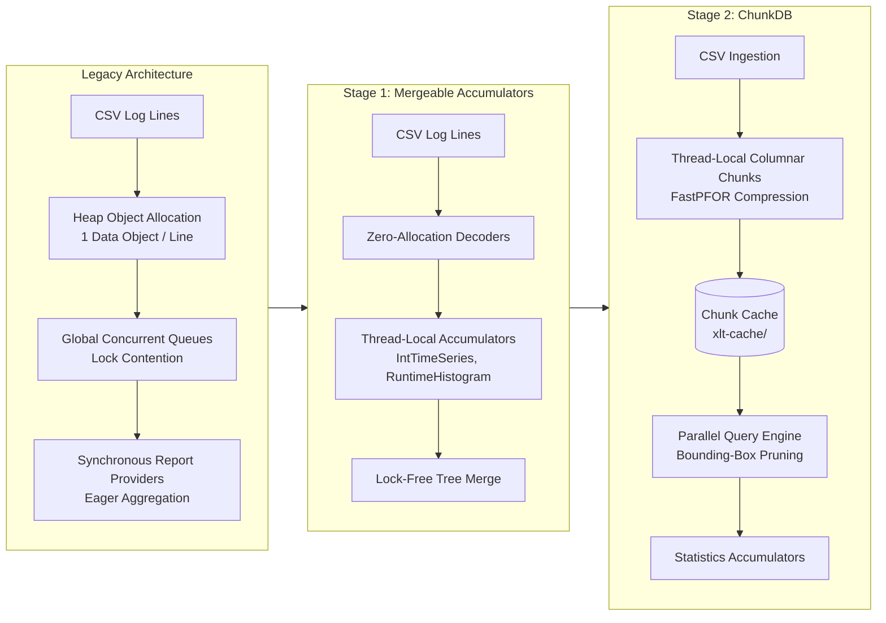
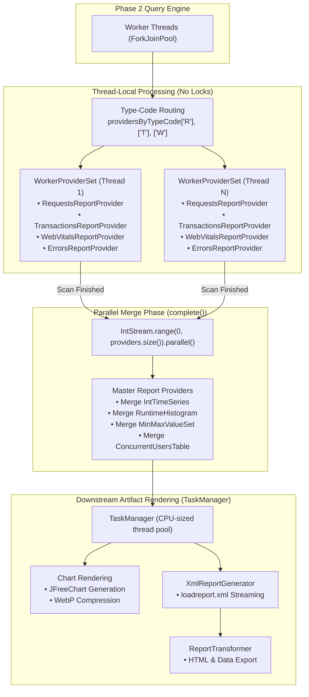
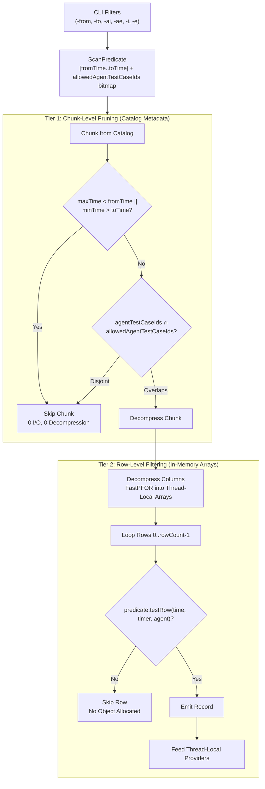

# XLT Pseudo-DB Mode (ChunkDB)

## 1. Overview & Motivation

### 1.1 What is Pseudo-DB Mode?
**Pseudo-DB Mode** (called **ChunkDB** in the code) is an embedded columnar storage and query layer in the XLT Report Generator (`com.xceptance.xlt.report.storage`). It splits report generation into two distinct phases: parsing raw CSV logs into compressed binary chunks on disk, and querying those chunks to compute report statistics.

When enabled (the default):
1. **Cold Run (first execution):** The generator parses raw CSV files, applies merge rules, and writes the records into columnar binary chunks in `xlt-cache/`. It then runs the report queries against these chunks.
2. **Warm Run (subsequent executions):** The generator skips reading the raw CSV files entirely. It queries the binary cache directly, scanning ~3.5 million records per second.

---

### 1.2 Evolution of the Report Generator



- **Legacy Pipeline:** Each CSV line was parsed into a Java object (`RequestData`, `TransactionData`, etc.) and pushed through blocking queues into synchronized report providers. On runs with 100M+ lines, threads spent substantial time waiting on locks, and the GC struggled with object churn and Old Gen promotion.
- **Stage 1 (Thread-Local Mergeable Accumulators):** Removed shared locks by giving each worker thread its own accumulators (`IntTimeSeries`, `RuntimeHistogram`, etc.). When parsing finished, thread accumulators were merged together. This roughly doubled throughput, but it eagerly folded all data into final summary statistics.
- **Stage 2 (Columnar ChunkDB):** Eager aggregation caused a workflow problem: any change in filter criteria (time window, agent selection, or scenario) required re-reading and re-parsing every CSV file from disk. ChunkDB keeps the underlying records in indexed columnar chunks so filters run against the cache instead.

---

### 1.3 Why Re-Filtering Was Slow
Load test analysis is rarely a one-shot task. In practice, engineers repeatedly slice the same dataset:
- Stripping ramp-up or cooldown periods (`-noRampUp`, `-from +15m`, `-to -10m`).
- Zooming into an incident window where response times spiked.
- Slicing a long soak test into hourly windows to spot degradation trends.
- Filtering by load agent (`-ai "Agent-0[1-5].*"`) or scenario (`-i "TCheckout.*"`).
- Tuning Apdex thresholds, chart properties, or scorecard criteria.

In a streaming pipeline without intermediate storage, every one of these filter adjustments meant re-reading and re-parsing tens of thousands of compressed `.csv.gz` files from disk—often taking 5 to 15 minutes each time.

ChunkDB saves the pre-parsed, interned records in a local binary cache. Re-running with different time ranges or agent filters queries the binary cache directly and finishes in seconds.

---

## 2. Two-Pass Pipeline Architecture

To process datasets exceeding 100 million records within a 4 GB JVM heap (`-Xmx4g`), ChunkDB separates ingestion and statistical aggregation into non-overlapping phases.

```mermaid
flowchart TD
    subgraph Phase1 ["Phase 1: Ingestion & Direct-to-Disk Spooling (Cold Run Only)"]
        direction TB
        RAW[Raw Results Directory<br/>timers.csv.gz files] --> DR[DataReaderThread Pool]
        DR --> DP[DataParserThread Pool<br/>CsvByteLineDecoder]
        DP --> MR[MergeRuleProcessor<br/>URL Normalization]
        MR --> CIC[ChunkIngestionCollector<br/>Thread-Local Chunk Builders]
        CIC --> COMP[ChunkCompressionWorkers<br/>FastPFOR Compression]
        COMP --> SPOOL[ChunkSpooler<br/>Direct-to-Disk chunks.bin.tmp]
        SPOOL --> FIN1[Promote to chunks.bin<br/>Append Tail Index & Dictionaries]
    end

    subgraph CacheValidation ["Cache Decision Engine"]
        CFP[CacheFingerprint Check<br/>Files + Bytes + Rule Hash + Version]
        CFP -- "Valid Cache" --> PEEK[Fast Bounds Peek<br/>peekTimeRange]
        CFP -- "Stale or Missing" --> Phase1
    end

    subgraph Phase2 ["Phase 2: Parallel SIMD Scan & Aggregation"]
        direction TB
        CS[(Chunk Catalog<br/>xlt-cache/)] --> CQE[ChunkQueryEngine]
        PRED[ScanPredicate<br/>Two-Tier Pruning] --> CQE
        CQE -->|Tier 1: [minTime, maxTime] & RoaringBitmap Intersection| PRUNE{Prune Chunk?}
        PRUNE -- "Yes (Disjoint)" --> SKIP[Skip Entire Chunk<br/>0 I/O, 0 CPU]
        PRUNE -- "No (Matches)" --> DECOMP[Column Decompression<br/>FastIntegerCodec]
        DECOMP --> CONTAINER[Reusable Thread-Local<br/>PostProcessedDataContainer]
        CONTAINER --> SP[StatisticsProcessor<br/>Worker Thread Aggregators]
        SP --> FINAL[Complete & Merge Statistics<br/>Generate HTML / PDF / Charts]
    end

    PEEK --> Phase2
    FIN1 --> Phase2
```

---

### 2.1 Phase 1: Ingestion and Spooling (Cold Run)

During a cold run, the goal is to parse raw logs, apply transformation rules, and write the facts to disk as fast as possible without filling the heap.

1. **Thread-Local Chunk Builders:**
   Each parser thread keeps its own array of `ChunkBuilder` instances indexed by record type code (`'R'`, `'T'`, `'A'`, etc.). Threads intern strings into dictionaries and append primitive column values independently, with no shared locks.
2. **Fixed Chunk Sizes:**
   Chunks hold a fixed count of **64,000 records** (`CHUNK_SIZE = 64_000`). Fixed boundaries give predictable primitive array sizes, avoid array resizing copies, and align with FastPFOR 128-integer blocks.
3. **Builder Recycling:**
   When a chunk fills up, it is handed off for compression. Instead of throwing away the builder and allocating new primitive arrays (~4.85 MB each), sealed builders are returned to a pool (`ConcurrentLinkedQueue<ChunkBuilder>[] recycledBuilders`) once their payload is serialized. This stops parser threads from churning through garbage.
4. **Asynchronous Compression:**
   Sealing a chunk submits its compression to a background pool (`compressionExecutor`) bounded by a `Semaphore`. Parser threads keep reading CSV lines without pausing for compression.
5. **Direct Disk Spooling (`ChunkSpooler`):**
   Compressed chunks are written straight to `chunks.bin.tmp`. Once written, the in-memory column data is dropped, leaving only an 80-byte `DiskChunk` metadata entry in memory.
6. **Separation of Memory:**
   `StatisticsProcessor` is completely idle during Phase 1. Heap memory is used only for active chunk builders and the small compression queue (< 150 MB). This leaves the heap clean and avoids Full GC pauses during ingestion.

---

### 2.2 Phase 2: Parallel Scan and Aggregation

Once Phase 1 finishes (or immediately if a valid cache already exists), `ChunkQueryEngine` runs a parallel scan over candidate chunks:

1. **Two-Tier Filtering (`ScanPredicate`):**
   - **Tier 1 (Chunk-Level Metadata):** Before reading or decompressing any chunk payload, the engine checks:
     $$\text{mayMatch} = (\text{chunk.maxTime} \ge t_{\text{from}}) \land (\text{chunk.minTime} \le t_{\text{to}}) \land \text{intersects}(\text{allowedTimers}, \text{chunkTimers}) \land \text{intersects}(\text{allowedAgents}, \text{chunkAgents})$$
     If this condition fails, the chunk is skipped completely. No disk read, no decompression.
   - **Tier 2 (Row-Level Scan):** For chunks that overlap the boundary of the query window, a loop checks timestamps and interned IDs row by row using primitive comparisons.
2. **Column Decompression:**
   Worker threads decompress FastPFOR integer vectors directly into thread-local arrays using SIMD bit-unpacking.
3. **Reusable Data Containers:**
   Decompressed records populate a pooled, thread-local `PostProcessedDataContainer` (up to 65,536 records). The container passes directly to `StatisticsProcessor.process(container, typeCode)`. No temporary wrapper objects are created during the scan.
4. **Scan Speed:**
   On a 16-core system, Phase 2 scans between **3.4 and 3.7 million records per second**.

---

### 2.3 Warm Run Execution

When running `./bin/create_report.sh` against an already ingested dataset:
1. `CacheManager.isCacheValid()` verifies the file count, total byte size, rule hash, and XLT version.
2. If valid, Phase 1 is skipped entirely.
3. `peekTimeRange()` reads the 44-byte binary header to resolve relative time arguments (like `--from +15m`) in less than 1 ms.
4. Worker threads read chunks concurrently from disk using positional NIO calls (`FileChannel.read(ByteBuffer, position)`).
5. A full report for **108M records finishes in roughly 35 to 40 seconds**.

---

## 3. Parallel Processing Behind StatisticsProcessor

Removing CSV parsing as the bottleneck exposed the next constraint: synchronization inside [`StatisticsProcessor`](file:///home/rschwietzke/projects/GIT/xlt-research-reporting/src/main/java/com/xceptance/xlt/report/StatisticsProcessor.java). Previously, threads competed for locks on shared report providers. The reporting layer was updated so all accumulators are thread-local and mergeable.



---

### 3.1 Lock Contention in the Legacy Design
In the earlier design, [`StatisticsProcessor`](file:///home/rschwietzke/projects/GIT/xlt-research-reporting/src/main/java/com/xceptance/xlt/report/StatisticsProcessor.java) held a single set of singleton [`ReportProvider`](file:///home/rschwietzke/projects/GIT/xlt-research-reporting/src/main/java/com/xceptance/xlt/api/report/ReportProvider.java) instances (`RequestsReportProvider`, `TransactionsReportProvider`, `ErrorsReportProvider`, etc.):
1. Threads competed to lock each provider (`provider.lock()`).
2. When a provider was busy, the contending thread spun and called `Thread.yield()`.
3. Updating start and end timestamps required acquiring a synchronized lock.
4. Every batch was passed to every provider, forcing each provider to inspect records with `instanceof`.

On 16- and 32-core systems, threads spent roughly a third of their CPU time spinning on locks and yielding, capping throughput regardless of how many cores were available.

---

### 3.2 Thread-Local Provider Sets (`WorkerProviderSet`)
To eliminate lock contention, `StatisticsProcessor` gives each thread its own set of providers:
- A [`ThreadLocal<WorkerProviderSet>`](file:///home/rschwietzke/projects/GIT/xlt-research-reporting/src/main/java/com/xceptance/xlt/report/StatisticsProcessor.java#L78-L105) creates an isolated copy of each configured [`ReportProvider`](file:///home/rschwietzke/projects/GIT/xlt-research-reporting/src/main/java/com/xceptance/xlt/api/report/ReportProvider.java) per worker thread.
- During Phase 2 scans, threads feed records exclusively into their local providers.
- No locks, atomic CAS instructions, or `Thread.yield()` calls are used while feeding records.

---

### 3.3 ASCII Type-Code Routing (`providersByTypeCode`)
Instead of passing every record to every provider, `StatisticsProcessor` dispatches records using an ASCII lookup table:
- Each provider declares which record types it handles via `boolean acceptsType(char typeCode)`.
- On thread startup, [`WorkerProviderSet`](file:///home/rschwietzke/projects/GIT/xlt-research-reporting/src/main/java/com/xceptance/xlt/report/StatisticsProcessor.java#L78-L105) builds a 128-element pre-filtered array:
  ```java
  final ReportProvider[][] providersByTypeCode = new ReportProvider[128][];
  ```
- When a chunk arrives from [`ChunkQueryEngine`](file:///home/rschwietzke/projects/GIT/xlt-research-reporting/src/main/java/com/xceptance/xlt/report/ChunkQueryEngine.java), [`StatisticsProcessor.process(dataContainer, typeCode)`](file:///home/rschwietzke/projects/GIT/xlt-research-reporting/src/main/java/com/xceptance/xlt/report/StatisticsProcessor.java#L238-L264) dispatches using `providersByTypeCode[typeCode]`:
  - Request chunks (`'R'`) dispatch only to `RequestsReportProvider` and `SummaryReportProvider`.
  - Transaction chunks (`'T'`) dispatch only to `TransactionsReportProvider` and `ErrorsReportProvider`.
  - Web Vital chunks (`'W'`) dispatch only to `WebVitalsDataProcessor`.
- Providers that do not care about a record type are skipped in $O(1)$ time without `instanceof` checks.

---

### 3.4 Mergeable Accumulators
For thread-local providers to work, each accumulator must support merging its state via `master.merge(worker)`:
1. **`IntTimeSeries`:** Time-series bins merge across threads with element-wise vector addition.
2. **`RuntimeHistogram`:** Scalable response time histograms merge bucket by bucket.
3. **`IntMinMaxValueSet` and `DoubleMinMaxValueSet`:** Min, max, count, and sum accumulators update in constant time.
4. **`ConcurrentUsersTable`:** Interval-based active user tracking merges intervals cleanly.
5. **`ApdexCalculator`:** Satisfied, tolerating, and frustrated counts sum together directly.
6. **`DoubleSummaryStatistics` & `IntSummaryStatistics`:** Standard Java statistical summaries merge with `combine()`.

---

### 3.5 Parallel Merge Phase (`StatisticsProcessor.complete()`)
Once all chunks have been scanned, the thread-local state is merged into the master report providers. 

Rather than iterating sequentially, [`StatisticsProcessor.complete()`](file:///home/rschwietzke/projects/GIT/xlt-research-reporting/src/main/java/com/xceptance/xlt/report/StatisticsProcessor.java#L372-L395) merges providers in parallel across available CPU cores:

```java
IntStream.range(0, reportProviders.size()).parallel().forEach(i -> {
    final ReportProvider master = reportProviders.get(i);
    for (final List<ReportProvider> workerList : workers) {
        final ReportProvider worker = workerList.get(i);
        master.merge(worker);
    }
});
```

Because each provider handles a separate domain (requests, transactions, actions, errors, web vitals), they merge concurrently. For a 108.8M record dataset across 16 worker threads, the entire merge step takes **under 50 milliseconds**.

---

### 3.6 Downstream Artifact Rendering (`TaskManager`)
Parallel execution continues into the rendering step in [`ReportGenerator.createReport()`](file:///home/rschwietzke/projects/GIT/xlt-research-reporting/src/main/java/com/xceptance/xlt/report/ReportGenerator.java#L679-L717):
1. **Global Task Pool:**
   [`TaskManager.getInstance()`](file:///home/rschwietzke/projects/GIT/xlt-research-reporting/src/main/java/com/xceptance/xlt/report/util/TaskManager.java) runs a thread pool sized to the number of CPU cores.
2. **Concurrent Chart Rendering:**
   Providers submit chart rendering jobs to `TaskManager`:
   - Response size charts
   - Response time histograms
   - Concurrent virtual user charts
   - Error distribution charts
   - WebP image encoding
3. **Overlapped XML Generation:**
   While worker threads render charts in the background, the main thread writes `loadreport.xml` via [`XmlReportGenerator`](file:///home/rschwietzke/projects/GIT/xlt-research-reporting/src/main/java/com/xceptance/xlt/report/XmlReportGenerator.java).
4. **Parallel HTML Generation:**
   [`ReportTransformer`](file:///home/rschwietzke/projects/GIT/xlt-research-reporting/src/main/java/com/xceptance/xlt/report/ReportTransformer.java) translates XML into HTML pages by dispatching multi-threaded XSLT tasks through `TaskManager`.

---

## 4. Columnar Binary Storage Format & Internals

When persisted, ChunkDB stores files in `<results-dir>/xlt-cache/`:

```
<results-dir>/xlt-cache/
├── fingerprint.bin    # File counts, byte totals, rule hashes, version
├── dictionaries.bin   # Interned string tables and sample URLs
└── chunks.bin         # V2 chunk data with tail index
```

---

### 4.1 Global Dictionaries (`dictionaries.bin`)
Deduplicating strings into 16-bit IDs avoids repeating text across millions of records. `GlobalDictionaries` interns:
- **Timer Names:** Request names, scenario names, action names, custom timers, and web vital metric names.
- **Agent & TestCase Pairs:** 16-bit compound keys encoding `(agentName, testCaseName)`.
- **HTTP Methods:** `GET`, `POST`, `PUT`, `DELETE`, etc.
- **MIME Content Types:** `text/html`, `application/json`, `image/jpeg`, etc.
- **IP Addresses:** Client and server IP strings.
- **Messages:** High-frequency event and error text.
- **Sample URLs:** Up to 5 representative URLs per timer name, with pre-parsed hostnames.

---

### 4.2 Binary Layout (`chunks.bin` - V2 Format)

`chunks.bin` consists of a 44-byte header, sequential compressed chunk payloads, and an index table at the end:

```
chunks.bin Layout:
┌────────────────────────────────────────────────────────────────────────┐
│ Global Header (44 Bytes)                                               │
│  - Magic Number: 0x584C5443 ("XLTC")                                   │
│  - Format Version: 2                                                   │
│  - Earliest Timestamp (long, ms since epoch)                           │
│  - Latest Timestamp (long, ms since epoch)                             │
│  - Total Row Count (long)                                              │
│  - Total Chunk Count (int)                                             │
│  - Tail Metadata Index Offset (long)                                   │
├────────────────────────────────────────────────────────────────────────┤
│ Chunk Payloads (Sequential FastPFOR Column Blocks)                     │
│  - Chunk 0 (e.g. 64,000 Requests)                                      │
│  - Chunk 1 (e.g. 64,000 Requests)                                      │
│  ...                                                                   │
│  - Chunk N                                                             │
├────────────────────────────────────────────────────────────────────────┤
│ Tail Metadata Index Table (Located at Index Offset)                   │
│  - Total Chunk Count (int)                                             │
│  - For each Chunk [0..N]:                                              │
│      * File Offset (long)                                              │
│      * Payload Byte Length (int)                                       │
│      * Record Type Code (char: 'R', 'T', 'A', etc.)                    │
│      * Row Count (int)                                                 │
│      * Min Timestamp (long)                                            │
│      * Max Timestamp (long)                                            │
│      * Timer RoaringBitmap (serialized)                                │
│      * Agent RoaringBitmap (serialized)                                │
└────────────────────────────────────────────────────────────────────────┘
```

**Why the index is at the tail:**
Putting the index at the end allows streaming chunks directly to disk during Phase 1 without knowing the total chunk count or file offsets in advance. On read, the reader seeks directly to `metadataIndexOffset` from the header and reads the full catalog into memory in ~15 ms. Worker threads can then read individual chunks concurrently using `FileChannel.read(ByteBuffer, fileOffset)`.

---

### 4.3 Compression Codecs

ChunkDB uses the `JavaFastPFOR` integer compression library and RoaringBitmaps:

1. **FastPFOR128:**
   Organizes integer arrays into 128-element blocks. Finds the minimum bit width needed for the block and packs the values with bit-shifts. Outliers exceeding that bit width are stored in a small exception section.
2. **VariableByte Tail Encoding:**
   FastPFOR operates on multiples of 128. Remaining entries at chunk boundaries are encoded with `VariableByte`.
3. **Monotonic Delta Encoding (`IntegratedBinaryPacking`):**
   Timestamps increase monotonically. Instead of writing 64-bit timestamps ($8 \text{ bytes} \times 64{,}000 = 512 \text{ KB}$), chunks record a base `minTime` (long) and relative offsets (`timeOffset`). Deltas ($d_i = t_i - t_{i-1}$) are calculated and packed into 2 to 4 bits per row.
4. **RoaringBitmaps:**
   Tracks distinct timer IDs, agent IDs, and failed row indices within each chunk. Allows fast set intersections when filtering.

---

### 4.4 Storage Footprint

Numbers from a production run with **108,790,200 records**:

| Data Type | Record Count | Bytes / Row (Compressed) | ChunkDB Size | Estimated Java Heap Size |
| :--- | :--- | :--- | :--- | :--- |
| **Requests (`'R'`)** | 98,500,000 | ~22 bytes | **~2.16 GB** | ~24.6 GB |
| **Actions (`'A'`)** | 8,900,000 | ~16 bytes | **~0.14 GB** | ~1.42 GB |
| **Transactions (`'T'`)** | 580,000 | ~20 bytes | **~0.01 GB** | ~0.12 GB |
| **Custom Timers (`'C'`)** | 810,000 | ~16 bytes | **~0.01 GB** | ~0.13 GB |
| **Dictionaries & Index** | - | - | **~0.08 GB** | - |
| **Total** | **108,790,200** | **~22.1 bytes** | **~2.40 GB** | **> 26 GB** |

Across all record types, ChunkDB averages ~22 bytes per row on disk, about a 10x reduction compared to in-memory Java objects and roughly 60% to 75% smaller than the original uncompressed CSV files.

---

### 4.5 Cache Validation (`CacheFingerprint`)

A cache in `xlt-cache/` is considered valid if four items match:
1. **Raw Log File Count:** Number of timer CSV files across all agent directories.
2. **Total File Size:** Combined byte size of all timer files. Adding or editing lines changes this value.
3. **Merge and Labeling Rules Hash:** SHA-256 digest of:
   - `com.xceptance.xlt.reportgenerator.requestMergeRules.*`
   - `com.xceptance.xlt.reportgenerator.labelingRules.*`
   - `com.xceptance.xlt.reportgenerator.removeIndexesFromRequestNames`
   (Because merge rules rewrite request names at parse time, altering rules invalidates the cache).
4. **XLT Version:** Prevents reading cache files written by a different version of XLT.

If any check fails, or if a cache file is corrupted, `CacheManager.purgeCache()` deletes `xlt-cache/` and falls back to a fresh CSV parse.

---

## 5. Data Feature Coverage

ChunkDB preserves all fields and record types available in standard XLT reports.

### 5.1 Coverage by Record Type

| Code | Class | Storage Handler | Storage Format | Reconstructed Data |
| :---: | :--- | :--- | :--- | :--- |
| **`R`** | `RequestData` | `RequestChunkHandler` | FastPFOR columnar arrays + Bitmaps | All 24 request metrics (timings, network phases, TTFB, TTLB, status codes, bytes, sample URLs, slowest outliers). |
| **`T`** | `TransactionData` | `TransactionChunkHandler` | FastPFOR columnar arrays + Sparse `TransactionError` map | Runtimes, user thread numbers, pass/fail status, stack traces, and ResultBrowser paths. |
| **`A`** | `ActionData` | `TimerChunkHandler('A')` | FastPFOR columnar arrays + Bitmaps | Action durations, timestamps, agent/testcase pairs, and pass/fail status. |
| **`C`** | `CustomData` | `TimerChunkHandler('C')` | FastPFOR columnar arrays + Bitmaps | Custom timer durations, timestamps, agent/testcase pairs, and pass/fail status. |
| **`P`** | `PageLoadTimingData` | `TimerChunkHandler('P')` | FastPFOR columnar arrays + Bitmaps | Page load event durations, timestamps, and pass/fail status. |
| **`W`** | `WebVitalData` | `DoubleValueChunkHandler('W')` | Integer metadata + unboxed `double[]` | Core Web Vitals (LCP, FID, CLS, INP, TTFB) floating-point values. |
| **`V`** | `CustomValue` | `DoubleValueChunkHandler('V')` | Integer metadata + unboxed `double[]` | Custom numeric metrics and gauges. |
| **`E`** | `EventData` | `EventChunkHandler` | FastPFOR columnar arrays + message dictionary | Event names, message strings, timestamps, agent/testcase pairs. |
| **`ERR`** | Error Reports | Derived from `R`, `T`, `E` | RoaringBitmaps + `TransactionError` + HTTP codes | Error counts, failure groupings, stack traces, and links to ResultBrowser dumps. |
| **`J`** / Custom | Custom Data | `GenericDataChunkHandler` | Columnar string IDs + reflection | JVM metrics (`JvmResourceUsageData`) and custom user record classes. |

---

### 5.2 Storage and Reconstruction Details

#### 1. Requests (`'R'`, `RequestData`)
Requests are the most frequent records and contain 24 fields. `RequestChunk` stores them as columnar vectors:
- **Timeline:** Monotonic `minTime` base with compressed `compTimeOffsets`.
- **Identifiers:** Interned 16-bit IDs for `timerNameId`, `agentTestCaseId`, `httpMethod`, `contentType`, `usedIp`, and `ipAddress`.
- **Metrics:** Compressed `compRunTimes`, `compResponseCodes`, `compBytesSent`, and `compBytesReceived`.
- **Network Phases:** Compressed columns for DNS, connect, send, wait (server busy), receive, TTFB, and TTLB.
- **Failures:** `RoaringBitmap failedRows` records failure flags without object overhead.
- **Sample URLs:** Ingestion keeps up to 5 representative URLs per timer ID in `GlobalDictionaries`. A lock-free check skips `getUrl().toString()` once the quota is reached. Scans read precomputed `CachedSampleUrl` objects (storing the URL string, parsed host name, and hash code) to avoid reparsing URLs.
- **Slowest Requests:** Outliers are collected dynamically by `SlowestRequestsReportProvider` during the scan, ensuring that slowest request tables reflect the queried time slice.

#### 2. Transactions (`'T'`, `TransactionData`)
Transactions represent end-to-end user scenarios:
- **Metrics:** Compressed columns for `compTimeOffsets`, `compTimerNameIds`, `compAgentTestCaseIds`, `compRunTimes`, and `compUserNumbers`.
- **Failures:** `RoaringBitmap failedRows` flags failed scenarios.
- **Error Details (`TransactionError`):** Because failures are typically rare (< 1% in normal runs), error diagnostics are stored out-of-band in a sparse `Map<Integer, TransactionError>` keyed by row index. This stores:
  - `failedActionName`: The action where the error occurred.
  - `stackTrace`: The exception message or assertion trace.
  - `directoryName`: The agent output directory containing the **ResultBrowser** DOM/HAR capture.
  Successful transactions use 0 bytes of error diagnostic storage.

#### 3. Actions (`'A'`), Custom Timers (`'C'`), and Page Timers (`'P'`)
Handled by `TimerChunk`:
- Stored as `compTimeOffsets`, `compTimerNameIds`, `compAgentTestCaseIds`, `compRunTimes`, and a `failedRows` bitmap.
- Scanned records stream directly into `ActionsReportProvider`, `CustomTimersReportProvider`, and `PageLoadTimingsReportProvider`.

#### 4. Core Web Vitals (`'W'`) and Custom Values (`'V'`)
Handled by `DoubleValueChunk`:
- Timestamps and metric names are compressed integers.
- Values are stored in a primitive `double[]` array without `Double` object boxing.

#### 5. Application Events (`'E'`, `EventData`)
Handled by `EventChunk`:
- Timestamps, event names, and agent/testcase IDs are compressed integers.
- Event messages reference interned strings in `GlobalDictionaries`.

#### 6. Errors and ResultBrowser Links
- Failed transaction counts and error categories come from `TransactionChunk.failedRows` and `errorDetails`.
- HTTP status codes (4xx, 5xx) come from `RequestChunk.failedRows` and `compResponseCodes`.
- When `com.xceptance.xlt.reportgenerator.linkToResultBrowsers = true`, error tables include hyperlinks to ResultBrowser captures using the stored `directoryName`.

#### 7. Generic Fallback (`GenericDataChunk`)
If a test run logs custom `Data` subclasses without a dedicated codec:
- Serializes the class name.
- Stores timestamps and agent/testcase IDs as compressed columns.
- Stores remaining tokenized CSV fields as interned string IDs.
- During query scans, `GenericDataChunkHandler` creates instances via reflection, calls `setBaseValues()` and `setRemainingValues()`, and passes them to report providers.

---

## 6. Dynamic Slicing & Filtering on Warm Cache

### 6.1 Two-Tier Query Engine

When filtering by time (`-from`, `-to`, `-l`, `-noRampUp`), scenario (`-i`, `-e`), or agent (`-ai`, `-ae`), ChunkDB uses a two-tier predicate ([`ScanPredicate`](file:///home/rschwietzke/projects/GIT/xlt-research-reporting/src/main/java/com/xceptance/xlt/report/storage/query/ScanPredicate.java)):



#### Tier 1: Chunk Pruning (Metadata Check)
Before decompressing a chunk payload, `ChunkQueryEngine` evaluates `ScanPredicate.mayMatchChunk(chunk)`:
1. **Time Check:** If `chunk.getMaxTime() < fromTime || chunk.getMinTime() > toTime`, the chunk is skipped.
2. **Agent and Scenario Check:**
   CLI regexes are matched once against the small `AgentTestCase` dictionary in `GlobalDictionaries` (`filterAgentTestCaseIds`), yielding a `RoaringBitmap allowedAgentTestCaseIds`. `mayMatchChunk` tests `RoaringBitmap.intersects(allowedAgentTestCaseIds, chunk.getAgentTestCaseIds())`. If disjoint, the chunk is skipped.

#### Tier 2: Row Filtering (In-Memory Primitive Scan)
For chunks that overlap the filter boundary:
- FastPFOR unpacks column arrays into thread-local primitive buffers.
- The scan loop checks `predicate.testRow(time, timerId, agentId)` on each row.
- Rows outside the filter are discarded immediately without allocating objects.
- Matching rows populate reusable pooled records in `PostProcessedDataContainer`.

---

### 6.2 Error Traces and ResultBrowser Links Under Filtering

Failures and stack traces are linked to individual rows, not global counters:

```
Row i: [Time: 14:12:05 | Agent: ac01 | Test: TOrder | FAILED]
  │
  ├──> predicate.testRow(time, timer, agent) == true
  │
  └──> Look up TransactionChunk.errorDetails.get(i)
            ├── failedActionName = "ClickCheckout"
            ├── stackTrace       = "AssertionError: Cart total mismatch..."
            └── directoryName    = "dump-0042"
                       │
                       ▼
         Link to ResultBrowser Snapshot:
         ac01/TOrder/0/output/dump-0042/index.html
```

#### 1. Row-Level Association
In `TransactionChunk`, failures are stored per row:
- The failure flag is stored in `RoaringBitmap failedRows`.
- Stack traces and action names are kept in `Map<Integer, TransactionError> errorDetails`, keyed by the row index.

#### 2. Filter Enforcement
In `TransactionChunkHandler.scan`:
```java
if (!predicate.testRow(time, timerId, agentId))
{
    continue; // Skips row and its error payload
}

final boolean failed = anyFailed && failedRows.contains(i);
data.setFailed(failed);
if (failed && errors != null)
{
    final TransactionChunk.TransactionError err = errors.get(i);
    if (err != null)
    {
        data.setFailedActionName(err.failedActionName());
        data.setFailureStackTrace(err.stackTrace());
        data.setDirectoryName(err.directoryName());
    }
}
```
If an error occurred outside the queried time window, or on an excluded agent, the row fails `testRow`. Its stack trace is never forwarded to `ErrorsReportProvider`.

#### 3. ResultBrowser Links
When a failed transaction passes the filter, its `directoryName` (e.g. `dump-0012`) is retained. `ErrorsReportProvider` combines this with `agentName`, `testCaseName`, and `userNumber` to build the link:
```
<agent>/<testcase>/<user>/output/<directoryName>/index.html
```
The error tables, exception distributions, and ResultBrowser links in the final report reflect only errors that occurred within the selected filter window.

---

### 6.3 URLs and Request Traces Under Filtering

1. **Metrics Recalculation:**
   Every request row stores its relative `timeOffset` and `agentTestCaseId`. When filtered, throughput, response times, HTTP status codes, byte counts, and network breakdown phases are calculated dynamically from the surviving rows.
2. **Sample URL Resolution:**
   `GlobalDictionaries` stores up to 5 representative URLs per timer ID (`CachedSampleUrl`). During query scans, matching `RequestData` rows look up their sample URLs via `dicts.getCachedSampleUrls(timerId)`. If an endpoint was not called within the filtered slice, it does not appear in the report.
3. **Slowest Requests:**
   `SlowestRequestsReportProvider` ranks the slowest requests dynamically from the records that pass the filter. An outlier from a discarded ramp-up period will not appear in a steady-state slice report.
4. **Distinct URL Count:**
   `RequestDataProcessor.distinctUrlsHLL` (HyperLogLog) receives only records that pass the filter, estimating unique URL counts accurately for that slice.

---

## 7. Performance & Operational Results

### 7.1 Production Benchmark
Measured on a dataset of **108,790,200 records across 49,358 files** (`bbw-2025-wah-2-281`) running on a 16-core machine with `-Xmx4g`:

| Metric | Legacy Pipeline | ChunkDB Cold Run | ChunkDB Warm Run | Difference |
| :--- | :--- | :--- | :--- | :--- |
| **Ingestion Time** | 322.5 s (337k lines/s) | **193.3 s (563k lines/s)** | **0.0 s (Bypassed)** | Phase 1 skipped on warm runs |
| **Full GC Pauses (Phase 1)**| 40 pauses (24.2 s total) | **0 pauses (0.0 s)** | **0 pauses (0.0 s)** | No Full GCs during ingestion |
| **Old Gen Heap Peak** | 3.48 GB (98% - near OOM) | **1.20 GB (stable)** | **2.60 GB (Phase 2 stats)** | Bounded heap usage |
| **Phase 2 Scan Rate** | N/A (Eager streaming) | **35.4 s (3.42M recs/s)** | **39.4 s (2.96M recs/s)** | Fast analytical querying |
| **Total Report Time** | **~6.5 minutes** | **~4.5 minutes** | **~40 seconds** | **~10x faster report iteration** |

---

### 7.2 Practical Benefits

1. **Faster Iterations:**
   Generating report variations (adjusting chart settings, Apdex thresholds, or scorecard rules) drops from 5–15 minutes to ~40 seconds.
2. **Fast Time Slicing:**
   `-from` and `-to` queries run against the binary catalog. Chunks outside the range are skipped via metadata without reading payload data.
3. **Low-Overhead Ramp-Up Stripping (`-noRampUp`):**
   Shifts the start predicate timestamp instead of re-reading raw files.
4. **Fast Agent and Scenario Filtering:**
   Evaluating `-ai` or `-i` uses RoaringBitmaps to skip non-matching chunks with bitwise operations.
5. **Stable Memory Usage:**
   Separating ingestion from aggregation keeps ingestion heap usage under 150 MB, preventing GC thrashing on large datasets.

---

## 8. Trade-offs and Limitations

1. **Disk Space Usage:**
   Caching requires local disk storage: roughly **20 to 25 MB per 1,000,000 records** (~2.4 GB for a 100M record run). Caching can be disabled (`-Dcom.xceptance.xlt.reportgenerator.dataCache.enabled=false`) or redirected to a different mount (`dataCache.dir`).
2. **Cold Run Compression Cost:**
   Compressing and writing chunks to disk on the first run takes CPU time. However, because compression runs in background threads and GC pressure is lower, the cold run is still ~30% faster than the legacy pipeline.
3. **Cache Invalidation on Merge Rule Changes:**
   Request merge rules (`requestMergeRules.*`) normalize dynamic URLs into timer names during Phase 1. If a rule changes, the cache cannot be reused. `CacheManager` detects the change and rebuilds the cache.
4. **Static Results Assumption:**
   ChunkDB assumes the raw results directory does not change after a test finishes. Adding log files changes the file count and byte sum, which invalidates the cache.
5. **Read-Only Filesystems:**
   In environments where results directories are mounted read-only, `ChunkSpooler` cannot write `xlt-cache/` there. The cache must be pointed to a writable directory via `com.xceptance.xlt.reportgenerator.dataCache.dir = /tmp/xlt-cache`.

---

## 9. Configuration, Switches & Operational Reference

### 9.1 Command-Line Switches

Supported switches in [`ReportGeneratorMain`](file:///home/rschwietzke/projects/GIT/xlt-research-reporting/src/main/java/com/xceptance/xlt/report/ReportGeneratorMain.java):

| Option (Short) | Option (Long) | Arguments | Default | Description & ChunkDB Behavior |
| :--- | :--- | :--- | :--- | :--- |
| **`-from`** | - | `<time>` | Earliest data | Start time. Accepts absolute format (`yyyyMMdd-HHmmss`) or relative offset (`+15m`, `-30m`). In ChunkDB mode, out-of-bounds chunks are skipped via catalog headers. |
| **`-to`** | - | `<time>` | Latest data | End time. Accepts absolute format (`yyyyMMdd-HHmmss`) or relative offset (`+15m`, `-30m`). Out-of-bounds chunks are skipped via catalog headers. |
| **`-l`** | - | `<duration>` | Full test | Restricts evaluation to a fixed duration (e.g. `15m`, `1h`). Must be paired with `-from` or `-to`. |
| **`-noRampUp`** | - | *None* | `false` | Automatically trims the ramp-up phase defined in `loadprofile.properties`. Adjusts the query start time without re-reading files. |
| **`-i`** | `--include-testcases` | `<regex,...>` | All | Comma-separated regex list of scenarios to include. Checked against chunk RoaringBitmaps to skip non-matching chunks. |
| **`-e`** | `--exclude-testcases` | `<regex,...>` | None | Comma-separated regex list of scenarios to exclude. |
| **`-ai`** | `--include-agents` | `<regex,...>` | All | Comma-separated regex list of load agents to include. Skips non-matching chunks via RoaringBitmap intersection. |
| **`-ae`** | `--exclude-agents` | `<regex,...>` | None | Comma-separated regex list of load agents to exclude. |
| **`-o`** | - | `<dir>` | `reports/<run>` | Custom output directory for the generated report. |
| **`-noCharts`** | `--no-charts` | *None* | `false` | Skips chart rendering and WebP compression for faster runs. |
| **`-noAgentCharts`** | `--no-agent-charts` | *None* | `false` | Skips per-agent charts while keeping overall aggregate charts. |
| **`-pdf`** | `--pdf` | *None* | `false` | Generates an executive PDF report (`loadreport.pdf`). |
| **`-linkToResults`** | - | `yes` \| `no` | Configured | Overrides whether failed transactions link to ResultBrowser DOM/HAR snapshots. |
| **`-timezone`** | - | `<tz-id>` | System default| Overrides the timezone used in reports and charts (e.g. `UTC`, `Europe/Berlin`). |
| **`-rating-score`** | `--rating-score` | `<score>` | Auto | Overrides the overall test scorecard grade (`A+`, `A`, `B`, `C`, `D`, `F`). |
| **`-rating-summary`**| `--rating-summary`| `<text>` | Auto | Overrides the scorecard summary text. |
| **`-pf`** | - | `<file>` | None | Loads an external properties file to override settings. |
| **`-D`** | - | `<key>=<value>`| None | Sets a configuration property directly (e.g. `-Dcom.xceptance.xlt.reportgenerator.dataCache.enabled=false`). |

---

### 9.2 Configuration Properties

Configured in `config/reportgenerator.properties` or overridden via `-D<key>=<value>`:

```properties
##
# Enables persistent ChunkDB binary disk caching.
# When true (default), cold runs write chunks to disk and warm runs read from cache.
#
# Default: true
com.xceptance.xlt.reportgenerator.dataCache.enabled = true

##
# Directory name or path for the cache.
# Relative paths are created inside the test results folder.
# Absolute paths point to a specific directory.
#
# Default: xlt-cache
com.xceptance.xlt.reportgenerator.dataCache.dir = xlt-cache

##
# Worker threads used for Phase 1 CSV parsing and Phase 2 query scanning.
#
# Default: Available CPU Cores
com.xceptance.xlt.reportgenerator.parser.threads = 16

##
# Worker threads used for reading raw CSV timer files from storage during Phase 1.
#
# Default: Available CPU Cores
com.xceptance.xlt.reportgenerator.reader.threads = 16

##
# WebP image compression factor for generated charts (0.0 - 1.0).
#
# Default: 0.85
com.xceptance.xlt.reportgenerator.charts.compression = 0.85

##
# Controls whether error tables link to ResultBrowser snapshots.
#
# Default: true
com.xceptance.xlt.reportgenerator.linkToResultBrowser = true

##
# Strips request index prefixes (e.g. "1.1 ", "2.3 ") from request names.
# Changing this property changes the cache fingerprint, triggering a rebuild.
#
# Default: true
com.xceptance.xlt.reportgenerator.removeIndexesFromRequestNames = true
```

---

### 9.3 Common CLI Examples

#### 1. Cold Run (Initial Report and Cache Creation)
```bash
# Parses CSV logs, builds xlt-cache/, renders charts, and creates HTML report
./bin/create_report.sh /path/to/results/test-run-2026-10-11
```

#### 2. Warm Run with Time Slicing
```bash
# Slices a 30-minute window from cache (~10-15s)
./bin/create_report.sh -from 20261011-141500 -to 20261011-144500 /path/to/results/test-run-2026-10-11

# Slices with relative offsets (skip first 15m ramp-up, trim last 10m)
./bin/create_report.sh -from +15m -to -10m /path/to/results/test-run-2026-10-11

# Slices fixed duration from start time
./bin/create_report.sh -from 20261011-140000 -l 30m /path/to/results/test-run-2026-10-11
```

#### 3. Automatic Ramp-Up Stripping
```bash
# Trims ramp-up based on loadprofile.properties using cached metadata
./bin/create_report.sh -noRampUp /path/to/results/test-run-2026-10-11
```

#### 4. Filtered Scenarios and Agents
```bash
# Filters for specific agent clusters
./bin/create_report.sh -ai "Agent-US-East-.*" /path/to/results/test-run-2026-10-11

# Includes checkout scenarios and excludes background polling
./bin/create_report.sh -i "TCheckout.*" -e "TPollStatus.*" /path/to/results/test-run-2026-10-11
```

#### 5. Fast Report Without Charts
```bash
# Skips chart generation for quick verification
./bin/create_report.sh -noCharts /path/to/results/test-run-2026-10-11

# Produces an executive PDF alongside HTML
./bin/create_report.sh -pdf /path/to/results/test-run-2026-10-11
```

#### 6. Redirecting Cache to Scratch Storage
```bash
# Points binary cache to local fast scratch storage (e.g. when results are on read-only mount)
./bin/create_report.sh -Dcom.xceptance.xlt.reportgenerator.dataCache.dir=/mnt/nvme/scratch/cache-20261011 /path/to/results/test-run-2026-10-11
```

#### 7. Disabling Cache
```bash
# Bypasses disk cache completely
./bin/create_report.sh -Dcom.xceptance.xlt.reportgenerator.dataCache.enabled=false /path/to/results/test-run-2026-10-11
```

---

### 9.4 Cache Maintenance & Troubleshooting

#### Invalidation
To force a complete re-read of raw CSV files:
```bash
# Remove the xlt-cache directory inside the results folder
rm -rf /path/to/results/test-run-2026-10-11/xlt-cache
```

#### Inspecting Cache Files
```bash
ls -lh /path/to/results/test-run-2026-10-11/xlt-cache/
# -rw-r--r-- 1 user group  2.4G Oct 11 14:05 chunks.bin
# -rw-r--r-- 1 user group   48M Oct 11 14:05 dictionaries.bin
# -rw-r--r-- 1 user group   128 Oct 11 14:05 fingerprint.bin
```

#### Cache Status in Logs
When reading from cache, the report generator logs:
```text
Reading Log Files...
Accelerating report generation using ChunkDB cache from: /path/to/results/test-run-2026-10-11/xlt-cache
ChunkDB query matched 1,702 of 1,702 chunks
108,790,200 records read from cache - 39,421 ms (load: 1,510 ms, scan: 37,911 ms) - 2,759,701 records/s
```

If the cache was stale or rules changed, it logs why it rebuilt:
```text
ChunkDB cache is stale (inputs or rules changed). Purging cache at: /path/to/results/test-run-2026-10-11/xlt-cache
Input directory: /path/to/results/test-run-2026-10-11
```
