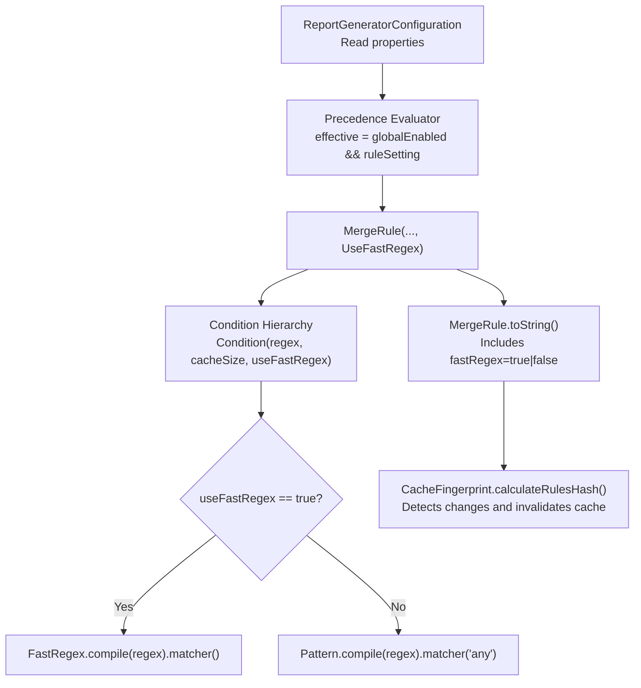

# Per-MergeRule Regex Engine Selection

* **Author:** Rene Schwietzke
* **Status:** Approved
* **Date:** 2026-11-10

---

## Overview

In XLT load test reports, request merge rules normalize dynamic request URLs and timer names into aggregated transaction buckets during Phase 1 report processing (the raw CSV log parsing and timer aggregation stage). The linear-time regular expression acceleration engine (FastRegex) executes these rules at high throughput by using SIMD literal scanning and deterministic state stepping. However, when a merge rule requires regular expression constructs not yet supported by FastRegex's AST parser or lazy DFA, FastRegex might fail to automatically detect the construct, leading to incorrect matches or runtime errors.

This feature introduces a per-rule configuration setting `com.xceptance.xlt.reportgenerator.requestMergeRules.<id>.fastRegex = true|false`. It allows report operators to explicitly disable FastRegex for a specific problematic rule, routing its patterns through the standard Java regular expression engine (`java.util.regex.Pattern`), while allowing all other merge rules to continue running under FastRegex.

## The Problem

Currently, FastRegex activation is controlled exclusively by the global feature flag:
`com.xceptance.xlt.reportgenerator.fastRegex.enabled = true|false` (default: `true`, with alias `com.xceptance.xlt.reportgenerator.requestMergeRules.fastRegex.enabled`).

When test suites contain complex, idiosyncratic regular expressions that FastRegex cannot parse or execute with 100% JDK fidelity, the automatic fallback mechanism may not recognize the unsupported construct. When this happens:
1. **False positive or false negative matching**: Requests are merged into the wrong buckets or skipped entirely.
2. **All-or-nothing operational trade-off**: To restore correct request naming, operators must disable FastRegex globally via `-Dcom.xceptance.xlt.reportgenerator.fastRegex.enabled=false`.
3. **Severe performance degradation**: Disabling FastRegex globally forces every merge rule to evaluate using standard `java.util.regex.Pattern`. On large datasets (50 to 500+ million requests), this increases Phase 1 report processing time by 15% to 40% and reintroduces high GC allocation rates and potential backtracking delays across the entire dataset.

Report operators need a targeted safety mechanism to force standard JDK regex execution for a specific rule without discarding FastRegex's performance advantages across the remainder of the test suite.

## Goals

* **Targeted Rule-Level Fallback**: Provide an optional boolean configuration property `com.xceptance.xlt.reportgenerator.requestMergeRules.<id>.fastRegex = true|false` that selectively forces standard regex matching for that rule when set to `false`.
* **Global Master Switch Precedence**: Ensure that the global flag (`fastRegex.enabled = false`) acts as an absolute master kill-switch: if FastRegex is globally disabled, no individual rule can enable FastRegex.
* **Universal Rule Coverage**: Apply the setting uniformly to all pattern conditions within the rule (including `urlPattern`, `namePattern`, `contentTypePattern`, `statusCodePattern`, `agentPattern`, `transactionPattern`, `methodPattern`, and their corresponding `.exclude` patterns).
* **Automatic Cache Fingerprint Invalidation**: Incorporate the effective regex engine state into `MergeRule.toString()` so that `CacheFingerprint` detects engine configuration changes and triggers an automatic cache rebuild in ChunkDB (XLT's intermediate columnar caching layer) without modifying the binary fingerprint format.
* **Silent Execution**: Operate silently without producing console warnings or log spam on stdout/stderr when rules override to standard regex or when a rule override is suppressed by the global kill-switch.

## Non-Goals

* **Sub-rule or Per-Condition Granularity**: Providing separate regex engine toggles for individual patterns inside the same rule (e.g. `urlPattern.fastRegex` vs `namePattern.fastRegex`) is explicitly out of scope. Rules operate as atomic units.
* **Regex Engine Changes Outside Merge Rules**: Changing regex execution engines for labeling rules (`LabelingRule`), general filtering (`StringMatcher`), or core string utilities (`RegExUtils.replaceAll`) is out of scope.
* **Internal FastRegex Engine Modifications**: This design does not modify FastRegex's AST parser, PikeVM, or DFA stepping logic; it provides an operational configuration escape hatch.

## Open Questions

* **Sub-rule granularity**: Resolved in brainstorming; rule-level atomicity satisfies all real-world requirements without configuration fragmentation.
* **Boolean vs Enum**: Resolved in brainstorming; boolean flag `fastRegex = true|false` is simpler, less error-prone, and matches existing properties.

## Critical User Journeys (CUJs)

### CUJ 1: Isolating a Problematic Rule with Explicit Opt-Out
* **Given**: FastRegex is enabled globally (`com.xceptance.xlt.reportgenerator.fastRegex.enabled = true`). Rule 5 contains an advanced regex syntax that FastRegex mishandles.
* **When**: The operator adds `com.xceptance.xlt.reportgenerator.requestMergeRules.5.fastRegex = false` to `reportgenerator.properties`.
* **Then**: Rule 5 executes using standard `java.util.regex.Pattern`, while rules 1–4 and 6–10 execute using `FastRegex`. The generated report groups requests correctly, and Phase 1 runs at near-FastRegex throughput.

### CUJ 2: Global Emergency Kill-Switch Suppressing Rule Override
* **Given**: Rule 2 defines `com.xceptance.xlt.reportgenerator.requestMergeRules.2.fastRegex = true`. An operator passes `-Dcom.xceptance.xlt.reportgenerator.fastRegex.enabled=false` on the CLI to debug an environment issue.
* **When**: Report generator parses configuration and executes Phase 1.
* **Then**: The global switch dominates. Rule 2 uses standard `java.util.regex.Pattern` along with all other rules. FastRegex does not initialize or execute.

### CUJ 3: Cache Invalidation on Engine Change
* **Given**: A report was generated with ChunkDB caching enabled, where Rule 3 defaulted to FastRegex.
* **When**: The operator changes Rule 3 to `com.xceptance.xlt.reportgenerator.requestMergeRules.3.fastRegex = false` and re-runs report generation.
* **Then**: `CacheFingerprint.calculate()` detects a hash mismatch in `.mergeRulesHash()` because `MergeRule.toString()` changed. The stale cache is invalidated and purged, and raw logs are re-parsed using standard regex for Rule 3.

---

## Technical Plan (Architecture)

### Architectural Overview

The configuration parsing, rule construction, and condition execution pipeline flows through four stages:



### 1. Configuration Property Resolution

In `ReportGeneratorConfiguration.java`:
* The global flag `this.fastRegexEnabled` is resolved at startup from:
  1. `com.xceptance.xlt.reportgenerator.fastRegex.enabled` (`PROP_FAST_REGEX_ENABLED`)
  2. `com.xceptance.xlt.reportgenerator.requestMergeRules.fastRegex.enabled` (`PROP_FAST_REGEX_ENABLED_ALIAS`)
  3. Default: `true`
* During merge rule construction (in `getMergeRules()`):
  For each rule number `i`:
  ```java
  final String basePropertyName = PROP_REQUEST_MERGE_RULES_PREFIX + i;
  final boolean ruleFastRegex = getBooleanProperty(basePropertyName + ".fastRegex", true);
  final boolean effectiveFastRegex = this.fastRegexEnabled && ruleFastRegex;
  final var useFastRegex = new UseFastRegex(effectiveFastRegex);
  ```

#### Precedence Truth Table

| Global `fastRegex.enabled` | Rule `<id>.fastRegex` | Effective Engine | Justification |
| :--- | :--- | :--- | :--- |
| `true` | *(unspecified, defaults `true`)* | **FastRegex** | Inherits global enabled state |
| `true` | `true` | **FastRegex** | Explicit rule opt-in under global enablement |
| `true` | `false` | **Standard `Pattern`** | Per-rule explicit opt-out |
| `false` | *(unspecified, defaults `true`)* | **Standard `Pattern`** | Inherits global disabled state |
| `false` | `true` | **Standard `Pattern`** | Global kill-switch strictly overrides rule preference |
| `false` | `false` | **Standard `Pattern`** | Both global and rule agree on standard engine |

### 2. Type-Safe Parameter Model in `MergeRule`

To follow the existing design of `MergeRule` and avoid identifier conflicts with `com.xceptance.util.fastregex.FastRegex`:
* Define a strongly-typed record in `MergeRule.java`:
  ```java
  public static record UseFastRegex(boolean value) {}
  ```
* Primary 24-argument constructor with `useFastRegex` placed at the end as the 24th parameter:
  ```java
  public MergeRule(final int id,
                   final NewName newName,
                   final NamePattern requestNamePattern,
                   final UrlPattern urlPattern,
                   final ContentTypePattern contentTypePattern,
                   final StatusCodePattern statusCodePattern,
                   final AgentNamePattern agentNamePattern,
                   final TransactionNamePattern transactionNamePattern,
                   final HttpMethodPattern httpMethodPattern,
                   final RunTimeRanges runTimeRanges,
                   final StopOnMatch stopOnMatch,
                   final NameExcludePattern requestNameExcludePattern,
                   final UrlExcludePattern urlExcludePattern,
                   final ContentTypeExcludePattern contentTypeExcludePattern,
                   final StatusCodeExcludePattern statusCodeExcludePattern,
                   final AgentNameExcludePattern agentNameExcludePattern,
                   final TransactionNameExcludePattern transactionNameExcludePattern,
                   final HttpMethodExcludePattern httpMethodExcludePattern,
                   final ContinueOnMatchAtId continueOnMatchAtId,
                   final ContinueOnNoMatchAtId continueOnNoMatchAtId,
                   final DropOnMatch dropOnMatch,
                   final UrlText urlText,
                   final UrlTextExclude urlTextExclude,
                   final UseFastRegex useFastRegex)
  ```
* Backward-compatible 23-argument overloaded constructor delegating to the primary constructor:
  ```java
  public MergeRule(final int id, final NewName newName, ..., final UrlTextExclude urlTextExclude)
  {
      this(id, newName, ..., urlText, urlTextExclude, new UseFastRegex(RegExUtils.isFastRegexEnabled()));
  }
  ```
* Public inspection method for test verification:
  ```java
  public boolean isUsingFastRegex()
  {
      return this.useFastRegex;
  }
  ```

### 3. Condition Hierarchy State Propagation

`Condition` and its subclasses receive the explicit `boolean useFastRegex` argument:
* `Condition.java`:
  ```java
  public Condition(final String regex, final int cacheSize, final boolean useFastRegex)
  {
      if (StringUtils.isBlank(regex))
      {
          this.fastMatcher = null;
          this.matcher = null;
      }
      else if (useFastRegex)
      {
          this.fastMatcher = FastRegex.compile(regex).matcher();
          this.matcher = null;
      }
      else
      {
          this.fastMatcher = null;
          this.matcher = Pattern.compile(regex).matcher("any");
      }
      ...
  }

  // Overloaded 2-arg constructor for existing code/tests
  public Condition(final String regex, final int cacheSize)
  {
      this(regex, cacheSize, RegExUtils.isFastRegexEnabled());
  }
  ```
* Note on non-regex conditions: `UrlConditionText` (plain substring search) and `UrlEmptyCondition` perform literal or empty checks without regular expressions and remain unchanged.
* All concrete condition subclasses with regular expressions and their static builder methods accept `boolean useFastRegex`:
  * `RequestNameCondition.build(regex, useFastRegex)` and `build(regex)`
  * `UrlCondition.build(regex, text, useFastRegex)` and `build(regex, text)`
  * `ContentTypeCondition.build(regex, useFastRegex)` and `build(regex)`
  * `StatusCodeCondition.build(regex, useFastRegex)` and `build(regex)`
  * `AgentNameCondition.build(regex, useFastRegex)` and `build(regex)`
  * `TransactionNameCondition.build(regex, useFastRegex)` and `build(regex)`
  * `HttpMethodCondition.build(regex, useFastRegex)` and `build(regex)`
  * `UrlConditionAndText(regex, text, useFastRegex)` and `(regex, text)`
  *(Each condition retains its legacy 1-parameter `build(regex)` overload delegating to `RegExUtils.isFastRegexEnabled()` for test compatibility.)*

### 4. Cache Invalidation Integration

In `MergeRule.java`, update the existing `toString()` method immediately after closing the filters bracket (`sb.append("]");`):
```java
@Override
public String toString()
{
    final StringBuilder sb = new StringBuilder();
    sb.append("Naming rule: '").append(newName).append("', filters:  [");
    ...
    sb.append("]");
    sb.append(", fastRegex=").append(useFastRegex);

    return sb.toString();
}
```

* `CacheFingerprint.calculateRulesHash()` serializes `rule.toString()` into a SHA-256 digest.
* When an operator changes `requestMergeRules.<id>.fastRegex`, `MergeRule.toString()` changes.
* `CacheFingerprint.matches()` evaluates to `false`, causing `CacheManager` to purge the old cache directory and reprocess Phase 1 from raw CSV logs with the updated engine.
* No changes to binary `fingerprint.bin` format or catalog version are needed.

### 5. Concurrency and Thread Safety

* Each `DataParserThread` independently calls `config.getMergeRules()`.
* Every parser thread compiles its own rule instances, its own matchers, and its own thread-confined `LRUClockMap` instances.
* There is zero shared state or cross-thread synchronization between parser threads.

---

## Alternatives Considered

### Alternative 1: String Enum Property (`regexEngine = fastregex | standard`)

* **Description**: Configure an engine identifier such as `requestMergeRules.<id>.regexEngine = fastregex | standard`.
* **Pros**: Extensible if a third regex engine (such as RE2/J or Hyperscan) is integrated in the future.
* **Cons**: Increases configuration parsing complexity, requires error handling for typos (e.g. `stanard`), and introduces inconsistent syntax compared to neighboring boolean properties (`stopOnMatch`, `dropOnMatch`).
* **Reason for Rejection**: Unnecessary complexity when only two engine options (FastRegex vs Standard JDK) are supported. The boolean flag `fastRegex = true|false` is simpler, less error-prone, and matches existing XLT property conventions.

### Alternative 2: Per-Pattern Property Granularity (`urlPattern.fastRegex`, `namePattern.fastRegex`)

* **Description**: Allow individual patterns within a single merge rule to configure their regex engine independently.
* **Pros**: Maximum theoretical flexibility for rare rules where only one specific pattern needs standard regex.
* **Cons**: Multiplies property surface area exponentially, adds cognitive overhead for test designers, and creates confusing multi-engine states within a single rule evaluation.
* **Reason for Rejection**: Rules are evaluated sequentially as logical units; all-or-nothing per rule satisfies all real-world requirements without configuration clutter.

### Alternative 3: Warning Logs when Overridden or Suppressed

* **Description**: Emit a `WARN` or `INFO` log when a rule opts out of FastRegex or when a rule's `fastRegex = true` request is muted by the global switch.
* **Pros**: High console visibility into which engine evaluates each rule.
* **Cons**: Violates XLT's standard of clean, minimal console output and creates repetitive log spam during regular test suite execution.
* **Reason for Rejection**: Configuration must execute silently without unnecessary log entries. Programmatic inspection via `isUsingFastRegex()` is available for diagnostics.

### Alternative 4: Global-Only Toggle (Status Quo)

* **Description**: Retain only the global `fastRegex.enabled` property without per-rule configuration.
* **Pros**: Zero code changes.
* **Cons**: Disabling FastRegex globally to fix a single rule's regex incompatibility penalizes every other rule across hundreds of millions of requests, causing 15%–40% slower report generation.
* **Reason for Rejection**: Operational throughput penalty across the entire dataset is too severe when only a single rule needs standard regex fallback.

---

## Risks & Limits

1. **Malformed Configuration Values**:
   * *Risk*: An operator configures a non-boolean string (e.g. `fastRegex = foo` or `fastRegex = 1`).
   * *Behavior & Mitigation*: Standard `getBooleanProperty(key, default)` evaluates `"true"` (case-insensitive) as `true` and any other string as `false` (or the default if empty). If `fastRegex` is unparseable or blank, it safely falls back according to standard XLT property semantics without crashing report generation.
2. **Positional Indexing Coupling**:
   * *Risk*: Rule configurations rely on positional integer IDs (`requestMergeRules.<id>.*`). Reordering or inserting rules can shift rule indices, detaching `.fastRegex = false` from the intended rule pattern.
   * *Mitigation*: This is the standard behavior across all existing merge rule properties (`.newName`, `.urlPattern`, etc.). Documentation in `FASTREGEX_MERGE_RULES_GUIDE.md` reminds operators to review all rule attributes when inserting or renumbering rules.
3. **Performance Impact of ReDoS in Standard Regex**:
   * *Risk*: Opting a high-volume rule out of FastRegex routes it to backtracking `java.util.regex.Pattern`. If the user's regular expression contains catastrophic backtracking patterns, report generation time may increase.
   * *Mitigation*: FastRegex's thread-confined match result caching (`LRUClockMap` in `Condition`) remains fully active even when using standard `Pattern`, caching identical repeated URL match results to cushion the backtracking overhead.

---

## Detailed Implementation Plan

This section provides the exhaustive, phased implementation plan for execution.

### Affected Files Directory

| Target File | Change Type | Rationale |
| :--- | :--- | :--- |
| `src/main/java/com/xceptance/xlt/report/mergerules/MergeRule.java` | Modified | Add `UseFastRegex` record, 24-arg constructor (with `UseFastRegex` at position 24), 23-arg delegation overload, condition builder updates, `public boolean isUsingFastRegex()` accessor, and `toString()` fingerprint integration. |
| `src/main/java/com/xceptance/xlt/report/mergerules/Condition.java` | Modified | Add `useFastRegex` parameter to constructor, retain 2-arg constructor overload, and initialize `fastMatcher` or `matcher` based on the passed flag. |
| `src/main/java/com/xceptance/xlt/report/mergerules/requestname/RequestNameCondition.java` | Modified | Propagate `useFastRegex` to constructor and static `build(...)` factory methods. |
| `src/main/java/com/xceptance/xlt/report/mergerules/url/UrlCondition.java` | Modified | Propagate `useFastRegex` to constructor and static `build(...)` factory methods. |
| `src/main/java/com/xceptance/xlt/report/mergerules/url/UrlConditionAndText.java` | Modified | Propagate `useFastRegex` to constructor. |
| `src/main/java/com/xceptance/xlt/report/mergerules/contenttype/ContentTypeCondition.java` | Modified | Propagate `useFastRegex` to constructor and static `build(...)` factory methods. |
| `src/main/java/com/xceptance/xlt/report/mergerules/statuscode/StatusCodeCondition.java` | Modified | Propagate `useFastRegex` to constructor and static `build(...)` factory methods. |
| `src/main/java/com/xceptance/xlt/report/mergerules/agent/AgentNameCondition.java` | Modified | Propagate `useFastRegex` to constructor and static `build(...)` factory methods. |
| `src/main/java/com/xceptance/xlt/report/mergerules/transaction/TransactionNameCondition.java` | Modified | Propagate `useFastRegex` to constructor and static `build(...)` factory methods. |
| `src/main/java/com/xceptance/xlt/report/mergerules/httpmethod/HttpMethodCondition.java` | Modified | Propagate `useFastRegex` to constructor and static `build(...)` factory methods. |
| `src/main/java/com/xceptance/xlt/report/ReportGeneratorConfiguration.java` | Modified | Parse `requestMergeRules.<id>.fastRegex`, calculate `effectiveFastRegex = fastRegexEnabled && ruleFastRegex`, and pass `new UseFastRegex(effectiveFastRegex)` to `MergeRule`. |
| `config/reportgenerator.properties` | Modified | Add commented configuration documentation and examples for `requestMergeRules.<id>.fastRegex`. |
| `docs/FASTREGEX_MERGE_RULES_GUIDE.md` | Modified | Document per-rule override behavior, precedence truth table, and practical examples in Section 3 and Section 7. |
| `src/test/java/com/xceptance/xlt/report/FastRegexSwitchTest.java` | Modified | Add unit and integration tests covering the full 6-cell truth table and cache fingerprint invalidation. |

### Phased Step-by-Step Implementation Sequence

#### Phase 1: Condition Hierarchy Extension
1. In `Condition.java`, add `public Condition(final String regex, final int cacheSize, final boolean useFastRegex)`. When `useFastRegex` is true, compile via `FastRegex.compile(regex).matcher()`; when false, compile via `Pattern.compile(regex).matcher("any")`. Retain the legacy `public Condition(final String regex, final int cacheSize)` delegating to `this(regex, cacheSize, RegExUtils.isFastRegexEnabled())`.
2. Update regex condition subclasses (`RequestNameCondition`, `UrlCondition`, `UrlConditionAndText`, `ContentTypeCondition`, `StatusCodeCondition`, `AgentNameCondition`, `TransactionNameCondition`, `HttpMethodCondition`):
   * Add `(regex, useFastRegex)` constructor.
   * Add `public static Condition build(final String regex, final boolean useFastRegex)`.
   * Retain legacy `build(final String regex) { return build(regex, RegExUtils.isFastRegexEnabled()); }`.
   *(Note: non-regex classes `UrlConditionText` and `UrlEmptyCondition` remain untouched).*
3. **Phase 1 Verification Checkpoint**: Run `mvn test-compile -Dtest=ConditionTest` to ensure all condition classes compile cleanly with backward-compatible overloads intact.

#### Phase 2: MergeRule Record & State Plumbing
1. In `MergeRule.java`, declare `public static record UseFastRegex(boolean value) {}`.
2. Add field `private final boolean useFastRegex;`.
3. Update primary constructor to accept `final UseFastRegex useFastRegex` as the 24th parameter (at the end of the argument list) and store `this.useFastRegex = useFastRegex.value();`. Pass `useFastRegex.value()` to all include and exclude condition `build(...)` calls.
4. Add 23-argument overloaded constructor:
   ```java
   public MergeRule(final int id, final NewName newName, ..., final UrlTextExclude urlTextExclude)
   {
       this(id, newName, ..., urlText, urlTextExclude, new UseFastRegex(RegExUtils.isFastRegexEnabled()));
   }
   ```
5. Add public test accessor `public boolean isUsingFastRegex() { return useFastRegex; }`.
6. In `MergeRule.toString()`, append `, fastRegex=` right after line 524 (`sb.append("]");`):
   ```java
   sb.append(", fastRegex=").append(useFastRegex);
   ```
7. **Phase 2 Verification Checkpoint**: Run `mvn test -Dtest=com.xceptance.xlt.report.mergerules.*Test` to verify that existing rule unit tests continue passing with the overloaded constructor.

#### Phase 3: Configuration Property Parsing
1. In `ReportGeneratorConfiguration.java`, inside the merge rule parsing loop (`getRuleNumbers(PROP_REQUEST_MERGE_RULES_PREFIX)`):
   * Parse `final boolean ruleFastRegex = getBooleanProperty(basePropertyName + ".fastRegex", true);`.
   * Compute `final boolean effectiveFastRegex = this.fastRegexEnabled && ruleFastRegex;`.
   * Pass `new UseFastRegex(effectiveFastRegex)` as the 24th argument when instantiating `MergeRule`.
2. **Phase 3 Verification Checkpoint**: Run `mvn test -Dtest=ReportGeneratorConfiguration_MergeRules_Test` to ensure existing configuration loading passes.

#### Phase 4: Properties, Documentation & Full Truth-Table Tests
1. In `config/reportgenerator.properties`, document the setting:
   ```properties
   ## Whether to use FastRegex for this specific rule (defaults to true).
   ## When set to false, standard Java regex (java.util.regex) is used for this rule.
   ## Note: If global FastRegex is disabled, FastRegex will not be used regardless of this setting.
   #com.xceptance.xlt.reportgenerator.requestMergeRules.1.fastRegex = true
   ```
2. In `docs/FASTREGEX_MERGE_RULES_GUIDE.md`, update Section 3 (Configuration & Feature Switch) with the per-rule override, truth table, and Section 7 practical examples.
3. In `FastRegexSwitchTest.java`, add comprehensive tests:
   * `testRuleOverrideToStandardRegexWhenGloballyEnabled`: Global `true`, Rule `fastRegex = false` $\rightarrow$ verifies `isUsingFastRegex() == false`.
   * `testRuleExplicitFastRegexWhenGloballyEnabled`: Global `true`, Rule `fastRegex = true` $\rightarrow$ verifies `isUsingFastRegex() == true`.
   * `testRuleDefaultFastRegexWhenGloballyEnabled`: Global `true`, Rule unspecified $\rightarrow$ verifies `isUsingFastRegex() == true`.
   * `testGlobalDisabledWithRuleExplicitTrue`: Global `false`, Rule `fastRegex = true` $\rightarrow$ verifies `isUsingFastRegex() == false`.
   * `testGlobalDisabledWithRuleExplicitFalse`: Global `false`, Rule `fastRegex = false` $\rightarrow$ verifies `isUsingFastRegex() == false`.
   * `testGlobalDisabledWithRuleUnspecified`: Global `false`, Rule unspecified $\rightarrow$ verifies `isUsingFastRegex() == false`.
   * `testCacheFingerprintDivergesOnFastRegexToggle`: Verifies `CacheFingerprint` hash divergence:
     ```java
     final CacheFingerprint fp1 = CacheFingerprint.calculate(resultsDir, config1);
     final CacheFingerprint fp2 = CacheFingerprint.calculate(resultsDir, config2);
     org.junit.Assert.assertNotEquals(fp1.mergeRulesHash(), fp2.mergeRulesHash());
     ```
4. **Phase 4 Verification Checkpoint**: Run `mvn test -Dtest=FastRegexSwitchTest` and `mvn test -Dtest=ChunkStorageAndCacheTest` to verify complete test suite execution.
