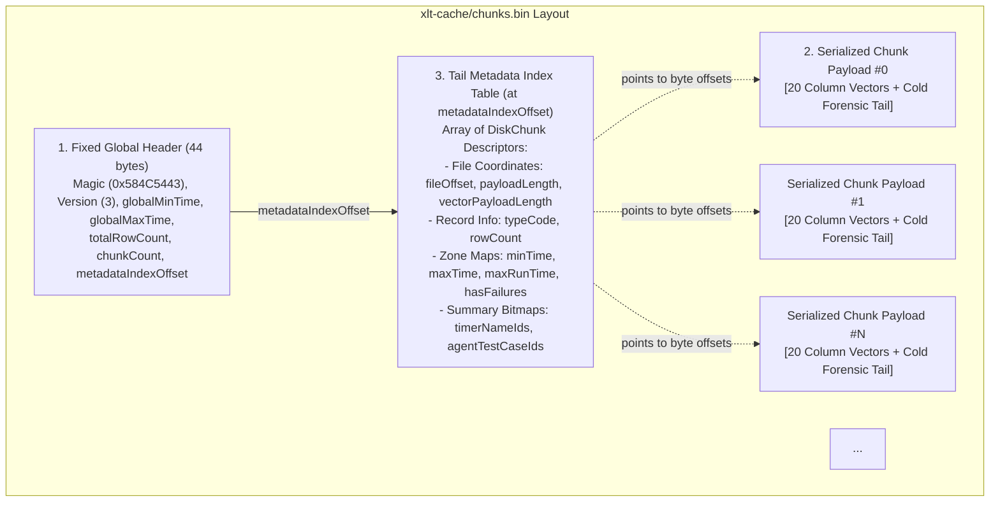
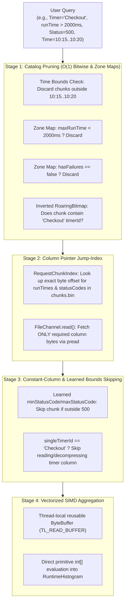

# ChunkDB Architecture Guide (`CHUNKDB_ARCHITECTURE_GUIDE.md`)

This guide explains the architectural principles, data layout, indexing mechanisms, and query execution engine of **ChunkDB**—the embedded, SIMD-compressed columnar storage engine in XLT.

---

## Table of Contents

1. [Executive Summary & Problem Statement](#1-executive-summary--problem-statement)
2. [Storage Model: Logical Chunks in a Single Physical Container](#2-storage-model-logical-chunks-in-a-single-physical-container)
   - [Logical Chunks vs. Physical Files](#logical-chunks-vs-physical-files)
   - [Why One File (`chunks.bin`) Instead of Thousands?](#why-one-file-chunksbin-instead-of-thousands)
   - [On-Disk Binary Layout & Tail Metadata Index Table](#on-disk-binary-layout--tail-metadata-index-table)
3. [Columnar Organization & Compression](#3-columnar-organization--compression)
   - [Columnar vs. Row-Oriented Layout](#columnar-vs-row-oriented-layout)
   - [Two-Tier Storage: Hot Vectors vs. Cold Forensic Tail](#two-tier-storage-hot-vectors-vs-cold-forensic-tail)
   - [Compression Strategies: FastPFOR & Global Dictionaries](#compression-strategies-fastpfor--global-dictionaries)
4. [Handling Unordered Time-Series Data](#4-handling-unordered-time-series-data)
   - [The Out-of-Order Reality in Load Testing](#the-out-of-order-reality-in-load-testing)
   - [Ingestion: Bounding Boxes Without Global Sorting](#ingestion-bounding-boxes-without-global-sorting)
   - [Overlapping Chunk Time Intervals](#overlapping-chunk-time-intervals)
   - [Query Time: Direct Mathematical Bucketing ($O(1)$ Scatter)](#query-time-direct-mathematical-bucketing-o1-scatter)
   - [When Chronological Sorting Is Needed (Top-K & Session Tracing)](#when-chronological-sorting-is-needed-top-k--session-tracing)
5. [How the Explorer Creates Indexes to Speed Things Up](#5-how-the-explorer-creates-indexes-to-speed-things-up)
   - [The Multi-Stage Pruning Pipeline](#the-multi-stage-pruning-pipeline)
   - [Stage 1: Catalog Pruning (Zone Maps & RoaringBitmaps)](#stage-1-catalog-pruning-zone-maps--roaringbitmaps)
   - [Stage 2: Column Pointer Jump-Index (`RequestChunkIndex`)](#stage-2-column-pointer-jump-index-requestchunkindex)
   - [Stage 3: Constant-Column & Learned Bounds Skipping](#stage-3-constant-column--learned-bounds-skipping)
   - [Stage 4: Zero-Allocation Positional Streaming & SIMD Aggregation](#stage-4-zero-allocation-positional-streaming--simd-aggregation)
6. [Key Components & Code Map](#6-key-components--code-map)

---

## 1. Executive Summary & Problem Statement

In large-scale performance tests, reports frequently analyze **50 to 500+ million records**. Traditional report architectures face two fatal bottlenecks:
1. **The Memory Wall**: Materializing millions of records as Java heap objects consumes tens of gigabytes of RAM, triggering severe GC pauses or `OutOfMemoryError`.
2. **The I/O Wall**: Re-parsing gigabytes of raw CSV logs every time an analyst brushes a chart or applies a filter takes minutes.

**ChunkDB** resolves this by operating as an embedded, SIMD-compressed, columnar OLAP storage engine (conceptually similar to Parquet or DuckDB, but zero-dependency and purpose-built for XLT test telemetry). It achieves:
* **~15 bytes/row** on disk (down from 200–500+ bytes in CSV).
* **< 100 MB JVM heap footprint** during multi-threaded scans over 100M+ rows.
* **Sub-50ms interactive query latency** in the ChunkDB Explorer UI.

---

## 2. Storage Model: Logical Chunks in a Single Physical Container

### Logical Chunks vs. Physical Files

Data in ChunkDB is divided **logically** into discrete, self-contained units called **chunks** ([`Chunk`](file:///home/rschwietzke/projects/GIT/xlt-research-reporting/src/main/java/com/xceptance/xlt/report/storage/chunk/Chunk.java)), each holding up to **64,000 records** of a specific type (e.g., `'R'` for HTTP Requests, `'T'` for Transactions, `'A'` for Actions).

However, physically, all chunks are packed sequentially into **one single container file** ([`chunks.bin`](file:///home/rschwietzke/projects/GIT/xlt-research-reporting/src/main/java/com/xceptance/xlt/report/storage/ChunkStorage.java#L67)), accompanied by interned string tables in `dictionaries.bin`.

### Why One File (`chunks.bin`) Instead of Thousands?

In a test with 100M requests, splitting data into 64K chunks creates **~1,560 chunks**; at 500M rows, it exceeds **8,000 chunks**. Writing each chunk as an individual file on disk would severely degrade performance:

1. **Filesystem Metadata & Inode Exhaustion**:
   Operating systems (ext4, NTFS, APFS) experience high latency when opening, closing, and updating directory tables for thousands of files.
2. **Thread-Safe, Zero-Lock Concurrent Reads via `FileChannel`**:
   ChunkDB opens a **single** read-only [`FileChannel`](file:///home/rschwietzke/projects/GIT/xlt-research-reporting/src/main/java/com/xceptance/xlt/report/storage/ChunkStorage.java#L85) at mount time. Positional reads (`FileChannel.read(ByteBuffer dst, long position)`) map to OS-level `pread` system calls:
   * They are completely thread-safe and non-locking.
   * 16 to 32 worker threads can read completely different chunks or specific column byte ranges concurrently without seeking, mutex contention, or exhausting OS file descriptors (`ulimit -n`).
3. **Pure Sequential Write Performance**:
   During Phase 1 log ingestion, [`ChunkSpooler`](file:///home/rschwietzke/projects/GIT/xlt-research-reporting/src/main/java/com/xceptance/xlt/report/storage/chunk/ChunkSpooler.java) appends completed chunks sequentially to `chunks.bin`. This achieves maximum disk throughput (often gigabytes per second on modern NVMe drives) without random-write penalties.
4. **Portability**:
   Moving, archiving, or transferring two unified files (`chunks.bin` and `dictionaries.bin`) is orders of magnitude faster than synchronizing directories with thousands of small files.

### On-Disk Binary Layout & Tail Metadata Index Table



#### Why the Metadata Index Table is at the File Tail
During log ingestion, the total number of chunks and their exact byte lengths cannot be known upfront. 
1. `ChunkSpooler` reserves 44 bytes at offset `0`.
2. As chunks fill up, their compressed payloads are streamed to disk sequentially.
3. Once all records are ingested, `ChunkSpooler.finish()` writes the **Metadata Index Table** starting at the end of the file (`metadataIndexOffset`).
4. Finally, it seeks back to byte `0` to write the 44-byte header containing the `metadataIndexOffset` pointer.

On subsequent report runs or Explorer launches, the server reads the 44-byte header and seeks directly to `metadataIndexOffset`. It loads all chunk descriptors into memory in **1–2 milliseconds**, achieving sub-second mounting.

---

## 3. Columnar Organization & Compression

### Columnar vs. Row-Oriented Layout

Traditional log stores and databases store rows sequentially:
$$\text{Row} = [\text{Time}, \text{TimerId}, \text{RunTime}, \text{StatusCode}, \text{Bytes}, \text{URL}, \dots]$$

If an analyst brushes a 30-second window to plot response times, a row-oriented database must read and deserialize every single field in every row.

ChunkDB organizes each 64K-record chunk into **21 independent column vectors**:
* Vector 0: `timeOffsets`
* Vector 1: `timerIds`
* Vector 2: `agentIds`
* Vector 3: `runTimes`
* Vector 4: `statusCodes`
* Vectors 5–13: `bytesSent`, `bytesReceived`, and 7 network sub-timings (DNS, Connect, Send, ServerBusy, Receive, TTFB, TTLB)
* Vectors 14–20: `httpMethods`, `contentTypes`, `usedIps`, `ipAddresses`, `userNumbers`, `formDataEncodings`, `urlHashes`

If a query only computes average latency, the engine reads **only columns 0 and 3**, skipping the remaining 19 columns entirely.

### Two-Tier Storage: Hot Vectors vs. Cold Forensic Tail

HTTP requests exhibit a sharp divide in data characteristics:
* **Metrics**: Numbers and small IDs (timestamps, runtimes, status codes) needed by 99% of chart and summary queries.
* **Forensic Details**: High-cardinality, variable-length strings (full URLs, request IDs, response IDs, POST bodies, raw unmerged names) only needed when diagnosing a specific outlier or failure.

ChunkDB physically isolates these within each request chunk:
1. **Hot Columnar Vectors (Front)**:
   The 21 primitive numeric columns, compressed via FastPFOR.
2. **Cold Forensic Tail Block (End)**:
   Stored at byte offset `vectorPayloadLength` as a Deflate-compressed UTF-8 slab.
   * **Default `sparse` mode**: Retains full forensic strings for all 4xx/5xx/failed requests plus the top-256 slowest requests per chunk (< 2% disk overhead).
   * **Opt-in `full` mode** (`--preserve-all-details`): Retains full forensic strings for 100% of rows.

> [!TIP]
> Time-series, histogram, and summary table queries read only up to `vectorPayloadLength` and **never read or decompress the forensic tail from disk**. The tail is inflated on demand only when an outlier is selected in the inspector.

### Compression Strategies: FastPFOR & Global Dictionaries

* **Global Dictionaries (`GlobalDictionaries`)**:
  High-frequency strings (timer names, agent names, scenario names, HTTP methods, MIME types, server IPs) are interned once into sequential 16-bit integer IDs (`0, 1, 2...`).
* **FastPFOR Integer Compression**:
  Timestamps are stored as delta offsets from the chunk’s `minTime`. All column vectors are bit-packed using SIMD-accelerated FastPFOR algorithms (`JavaFastPFOR`), decoding tens of millions of integers per second per CPU core.

---

## 4. Handling Unordered Time-Series Data

### The Out-of-Order Reality in Load Testing

In modern load tests, telemetry arrives out of chronological order:
* Dozens of load generator machines and hundreds of concurrent worker threads flush logs independently.
* Log files from different virtual users (e.g., `User_1` and `User_48`) cover overlapping time windows (e.g., both run from `10:00:00` to `10:15:00`).
* Ingestion pipelines process files in parallel.

ChunkDB is explicitly designed to handle this **without performing expensive global sorting**.

### Ingestion: Bounding Boxes Without Global Sorting

During Phase 1 log parsing:
1. When a chunk builder ([`RequestChunkBuilder`](file:///home/rschwietzke/projects/GIT/xlt-research-reporting/src/main/java/com/xceptance/xlt/report/storage/chunk/RequestChunkHandler.java#L1190)) receives records, it simply tracks its local bounding box:
   ```java
   if (time < minTime) minTime = time;
   if (time > maxTime) maxTime = time;
   rawTimes[count] = time;
   ```
2. When the chunk is sealed, timestamps are converted into relative offsets:
   $$\text{timeOffset}_i = \text{rawTimes}_i - \text{minTime}$$
3. **No sorting occurs within or across chunks**.

### Overlapping Chunk Time Intervals

Because there is no global sort, chunk time spans freely overlap:
* **Chunk A**: covers `10:00:00 – 10:14:30` (records from Agent 1)
* **Chunk B**: covers `10:03:15 – 10:18:00` (records from Agent 2)

The [`ChunkCatalog`](file:///home/rschwietzke/projects/GIT/xlt-research-reporting/src/main/java/com/xceptance/xlt/report/storage/catalog/ChunkCatalog.java) simply registers each chunk’s `[minTime, maxTime]` bounding box. A query targeting `10:05:00 – 10:10:00` uses standard interval intersection:
$$\text{mayMatch} = \neg(\text{chunk.maxTime} < \text{fromTime} \lor \text{chunk.minTime} > \text{toTime})$$
Both Chunk A and Chunk B are selected as candidates and scanned in parallel.

### Query Time: Direct Mathematical Bucketing ($O(1)$ Scatter)

When generating time-series charts (e.g., 1-second or 1-minute buckets of RPS, mean, and percentiles), **the engine never sorts the incoming rows**.

Instead, it uses **direct bucket indexing**:
$$\text{bucketIndex} = \left\lfloor \frac{\text{rowTime} - \text{queryFromTime}}{\text{bucketWidthMs}} \right\rfloor$$

```
Unordered Rows:
Row at 10:12:05 ──► (10:12:05 - 10:00:00) / 60s ──► Bucket #12
Row at 10:02:30 ──► (10:02:30 - 10:00:00) / 60s ──► Bucket #2
Row at 10:12:45 ──► (10:12:45 - 10:00:00) / 60s ──► Bucket #12
```

* Each record calculates its target bucket in a **single arithmetic instruction** and increments that bucket's counters and [`RuntimeHistogram`](file:///home/rschwietzke/projects/GIT/xlt-research-reporting/src/main/java/com/xceptance/xlt/report/util/RuntimeHistogram.java).
* Order of arrival is completely irrelevant.
* Each parallel thread updates its own `TimeSeriesAccumulator` instance. At the end of the scan, the accumulators are merged.
* The output is **guaranteed to be in perfect chronological order** because the array of buckets `[Bucket 0, Bucket 1, Bucket 2, ...]` is ordered by definition.

### When Chronological Sorting Is Needed (Top-K & Session Tracing)

When an analyst explicitly requests a chronological waterfall:
* **Top-K Slowest Outliers**: Uses a bounded `PriorityQueue` (heap) during the parallel scan to hold only the top 100 rows. Millions of non-outlier rows are discarded without sorting.
* **Virtual User Session Waterfall**: The engine filters by `(agentId, scenarioId, userNumber)` across chunks, collects only the few hundred events executed by that single user, and sorts **only that small list** in memory.

---

## 5. How the Explorer Creates Indexes to Speed Things Up

The [`ColumnarQueryEngine`](file:///home/rschwietzke/projects/GIT/xlt-research-reporting/src/main/java/com/xceptance/xlt/report/query/ColumnarQueryEngine.java) delivers interactive response times (< 50ms) across hundreds of millions of records using a **4-stage pruning and skipping pipeline**:



### Stage 1: Catalog Pruning (Zone Maps & RoaringBitmaps)

Before reading a single byte from disk, [`ScanPredicate.mayMatchChunk()`](file:///home/rschwietzke/projects/GIT/xlt-research-reporting/src/main/java/com/xceptance/xlt/report/storage/query/ScanPredicate.java#L147) prunes candidate chunks:
1. **Time Boundaries**: Checks if `[chunk.minTime, chunk.maxTime]` intersects `[fromTime, toTime]`.
2. **Latency Zone Map (`maxRunTime`)**: Each chunk header records its worst latency. If a query filters for `runTime >= 3000ms`, any chunk where `maxRunTime < 3000` is rejected instantly.
3. **Failure Zone Map (`hasFailures`)**: Chunks store a boolean flag indicating if any error or 4xx/5xx status occurred. Error-only queries drop 99% of successful chunks immediately.
4. **Inverted RoaringBitmap Intersection**: The catalog maintains an inverted index mapping `timerNameId -> RoaringBitmap(chunkIndices)`. Filtering by timer performs a bitwise intersection, pruning non-matching chunks in microseconds.

### Stage 2: Column Pointer Jump-Index (`RequestChunkIndex`)

Instead of decompressing entire chunks into the JVM heap, the engine builds a lightweight in-memory descriptor called `RequestChunkIndex` (~250 bytes per chunk):
* **Startup Jump-Scan**: On startup, worker threads read only the 4-byte length headers for each of the 21 columns across all chunks (~750 ms and ~1.5 MB RAM for 485 million rows).
* **Positional File Channel Offsets**: It maps the exact byte offset and compressed length of every column inside `chunks.bin`.
* **Surgical Column Reads**: When scanning a chunk, the engine reads **only the required column bytes** directly from disk into a reusable thread-local buffer via `FileChannel.read(buffer, offset)`. Unrequested columns are never read from disk.

### Stage 3: Constant-Column & Learned Bounds Skipping

1. **Single-Value Hints**:
   In load tests, an entire 64,000-row chunk often belongs to just one timer (e.g., all rows are `"Homepage"`), one agent, or one HTTP method (`"GET"`). The index detects this:
   * If the query filters for a different timer, the chunk is rejected in $O(1)$ time.
   * If the query matches that timer, the engine **skips reading and decompressing the timer column entirely**—it already knows every row matches.
2. **Learned Status Code Bounds**:
   When status codes are first read, the index caches `minStatusCode` and `maxStatusCode` (e.g., `min: 200, max: 200`). Subsequent queries looking for errors immediately skip this chunk without disk reads.

### Stage 4: Zero-Allocation Positional Streaming & SIMD Aggregation

* **Zero Object Allocations**: The engine never instantiates row POJOs (like `RequestData`).
* **Reusable Buffers**: Worker threads share a thread-local direct buffer ([`TL_READ_BUFFER`](file:///home/rschwietzke/projects/GIT/xlt-research-reporting/src/main/java/com/xceptance/xlt/report/query/ColumnarQueryEngine.java#L148-L162)).
* **Primitive SIMD Loops**: Filtering and histogram updates operate directly over primitive `int[]` vectors, keeping CPU caches hot and eliminating GC pauses.

---

## 6. Key Components & Code Map

| Component / Class | File Location | Responsibility |
| :--- | :--- | :--- |
| **`ChunkStorage`** | [`ChunkStorage.java`](file:///home/rschwietzke/projects/GIT/xlt-research-reporting/src/main/java/com/xceptance/xlt/report/storage/ChunkStorage.java) | Top-level storage manager; unifies dictionaries, catalog, and the single `readChannel`. |
| **`ChunkCatalog`** | [`ChunkCatalog.java`](file:///home/rschwietzke/projects/GIT/xlt-research-reporting/src/main/java/com/xceptance/xlt/report/storage/catalog/ChunkCatalog.java) | Master inventory of all `DiskChunk` descriptors, global bounds, and inverted `RoaringBitmap` indexes. |
| **`DiskChunk`** | [`DiskChunk.java`](file:///home/rschwietzke/projects/GIT/xlt-research-reporting/src/main/java/com/xceptance/xlt/report/storage/chunk/DiskChunk.java) | Lightweight (~80 bytes) in-memory chunk descriptor holding file coordinates, time bounds, and Zone Maps. |
| **`ChunkSpooler`** | [`ChunkSpooler.java`](file:///home/rschwietzke/projects/GIT/xlt-research-reporting/src/main/java/com/xceptance/xlt/report/storage/chunk/ChunkSpooler.java) | Appends compressed chunks sequentially to `chunks.bin` and writes the Tail Metadata Index Table. |
| **`RequestChunkHandler`** | [`RequestChunkHandler.java`](file:///home/rschwietzke/projects/GIT/xlt-research-reporting/src/main/java/com/xceptance/xlt/report/storage/chunk/RequestChunkHandler.java) | FastPFOR columnar codec for HTTP requests; manages Hot Vectors and the Cold Forensic Tail Block. |
| **`ScanPredicate`** | [`ScanPredicate.java`](file:///home/rschwietzke/projects/GIT/xlt-research-reporting/src/main/java/com/xceptance/xlt/report/storage/query/ScanPredicate.java) | Two-tier query filter evaluating $O(1)$ chunk pruning and row-level primitive predicates. |
| **`ColumnarQueryEngine`** | [`ColumnarQueryEngine.java`](file:///home/rschwietzke/projects/GIT/xlt-research-reporting/src/main/java/com/xceptance/xlt/report/query/ColumnarQueryEngine.java) | Vectorized query engine with in-memory column pointer jump-indexing, learned hints, and parallel bucketing. |
| **`ChunkApiServlet`** | [`ChunkApiServlet.java`](file:///home/rschwietzke/projects/GIT/xlt-research-reporting/src/main/java/com/xceptance/xlt/report/server/ChunkApiServlet.java) | Embedded Jetty REST servlet exposing `/api/v1/metadata`, `/timeseries`, `/summary-table`, `/inspect`, and `/session`. |
| **`ChunkExplorerMain`** | [`ChunkExplorerMain.java`](file:///home/rschwietzke/projects/GIT/xlt-research-reporting/src/main/java/com/xceptance/xlt/report/server/ChunkExplorerMain.java) | Dedicated CLI entry point launching the embedded Jetty web server and UI workbench. |
