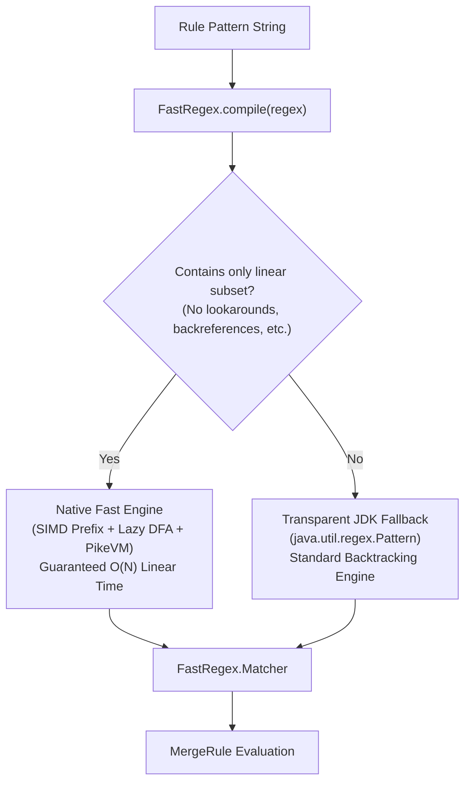
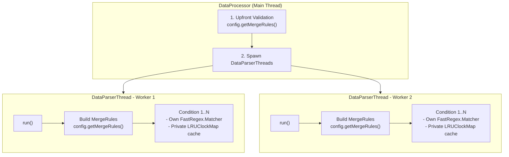

# FastRegex in Request Merge Rules (`FASTREGEX_MERGE_RULES_GUIDE.md`)

This guide explains the integration, configuration, architecture, and supported regular expression syntax of **FastRegex**—the linear-time regular expression acceleration engine embedded in XLT for request merge rules.

---

## Table of Contents

1. [Overview & Motivation](#1-overview--motivation)
2. [Scope of FastRegex in XLT](#2-scope-of-fastregex-in-xlt)
3. [Configuration & Feature Switch](#3-configuration--feature-switch)
4. [Supported Regular Expression Syntax Specification](#4-supported-regular-expression-syntax-specification)
   - [Native Fast Engine (Guaranteed Linear Time $O(N)$)](#native-fast-engine-guaranteed-linear-time-on)
   - [Constructs Triggering Transparent JDK Fallback](#constructs-triggering-transparent-jdk-fallback)
   - [Malformed Syntax (Rejected with `PatternSyntaxException`)](#malformed-syntax-rejected-with-patternsyntaxexception)
5. [Architecture & Concurrency (Shared-Nothing Design)](#5-architecture--concurrency-shared-nothing-design)
   - [Per-Parser-Thread Rule Instantiation](#per-parser-thread-rule-instantiation)
   - [Thread-Confined Match Result Caching](#thread-confined-match-result-caching)
   - [Fail-Fast Upfront Validation](#fail-fast-upfront-validation)
6. [Performance & Benchmark Results](#6-performance--benchmark-results)
7. [Practical Merge Rule Examples](#7-practical-merge-rule-examples)
8. [Troubleshooting & Diagnostics](#8-troubleshooting--diagnostics)

---

## 1. Overview & Motivation

In large-scale performance tests, reports frequently process **50 to 500+ million HTTP request records**. During Phase 1 report generation, each parsed request is evaluated against a configured sequence of **Request Merge Rules** to normalize dynamic URLs (e.g. `/products/12345` $\rightarrow$ `Product.{u:1}`) and aggregate metrics into meaningful transaction groups.

When test suites define dozens of merge rules, evaluating standard regular expressions (`java.util.regex.Pattern`) against millions of URLs represents a significant CPU bottleneck:
* Standard NFA engines can exhibit high backtracking overhead on non-matching URLs.
* Intermediate string and matcher allocations create continuous garbage collector (GC) pressure.
* Shared caches or synchronized regex access across concurrent parser threads lead to thread contention.

**FastRegex** (`com.xceptance.util.fastregex.FastRegex`) addresses this bottleneck by replacing standard regex matching during request merge rule processing with a Java 21 high-performance hybrid engine that combines:
1. **SIMD-Accelerated Literal Prefix Scanning**: Automatically extracts deterministic leading literal substrings and scans incoming text using JVM AVX2 / AVX-512 / ARM NEON intrinsics via vectorized `String.indexOf`.
2. **On-Demand Lazy DFA State Stepping**: Caches deterministic state transitions dynamically for $O(1)$ character stepping (a single array lookup per input character).
3. **Priority-Ordered PikeVM**: Evaluates non-deterministic or capturing sub-expressions with guaranteed linear $O(N)$ execution time, eliminating catastrophic backtracking (ReDoS).
4. **Transparent JDK Fallback**: Seamlessly delegates complex, non-linear constructs (such as lookarounds and backreferences) to `java.util.regex.Pattern`, ensuring 100% backward compatibility with all existing user rules.

---

## 2. Scope of FastRegex in XLT

> [!IMPORTANT]
> FastRegex is strictly and exclusively utilized for **Request Merge Rules** (`com.xceptance.xlt.report.mergerules`).

FastRegex is **not** used as a global regex replacement across the XLT codebase. Components outside request merge rules continue to use standard `java.util.regex.Pattern`:
* **General Filtering**: [`StringMatcher`](file:///home/rschwietzke/.gemini/antigravity/worktrees/xlt-research-reporting/evaluate_new_regexp_engine/src/main/java/com/xceptance/common/util/StringMatcher.java) for test case, timer, and agent include/exclude filters uses standard JDK `Pattern`.
* **Post-Processing Rules**: [`LabelingRule`](file:///home/rschwietzke/.gemini/antigravity/worktrees/xlt-research-reporting/evaluate_new_regexp_engine/src/main/java/com/xceptance/xlt/report/labelingrules/LabelingRule.java) uses standard JDK `Pattern`.
* **Utility Methods**: General string utilities in [`RegExUtils`](file:///home/rschwietzke/.gemini/antigravity/worktrees/xlt-research-reporting/evaluate_new_regexp_engine/src/main/java/com/xceptance/common/util/RegExUtils.java) (e.g. `replaceAll`, `getPattern`) continue to use standard JDK `Pattern`.

---

## 3. Configuration & Feature Switch

FastRegex is **enabled by default** in XLT. It can be toggled via configuration files or command-line system properties.

### Property Definition

```properties
## Whether to use the fast linear-time regular expression engine (FastRegex)
## for request merge rules (defaults to true).
com.xceptance.xlt.reportgenerator.fastRegex.enabled = true
```

*(Note: The alias `com.xceptance.xlt.reportgenerator.requestMergeRules.fastRegex.enabled` is also supported as a fallback).*

### Configuration Options

1. **In `config/reportgenerator.properties`**:
   ```properties
   # Disable FastRegex to fall back to java.util.regex.Pattern
   com.xceptance.xlt.reportgenerator.fastRegex.enabled = false
   ```

2. **Via Command-Line System Property (`-D`)**:
   ```bash
   ./bin/create_report.sh -Dcom.xceptance.xlt.reportgenerator.fastRegex.enabled=false /path/to/results
   ```

3. **In Java Code**:
   ```java
   // Programmatic inspection and control
   boolean isEnabled = RegExUtils.isFastRegexEnabled();
   RegExUtils.setFastRegexEnabled(false);
   ```

### Per-Rule Engine Override

In addition to the global toggle, individual request merge rules can explicitly configure whether to use FastRegex or standard Java regex via:

```properties
com.xceptance.xlt.reportgenerator.requestMergeRules.<id>.fastRegex = true|false
```

* **Default**: `true` (inherits global FastRegex execution).
* **Per-Rule Opt-Out**: When set to `false`, that specific rule evaluates its patterns using standard `java.util.regex.Pattern`, while all other rules continue running under FastRegex.
* **Global Master Switch Precedence**: The global setting (`fastRegex.enabled = false`) acts as an absolute master kill-switch. If FastRegex is globally disabled, no individual rule can enable FastRegex.

#### Precedence Truth Table

| Global `fastRegex.enabled` | Rule `<id>.fastRegex` | Effective Engine | Justification |
| :--- | :--- | :--- | :--- |
| `true` | *(unspecified, defaults `true`)* | **FastRegex** | Inherits global enabled state |
| `true` | `true` | **FastRegex** | Explicit rule opt-in under global enablement |
| `true` | `false` | **Standard `Pattern`** | Per-rule explicit opt-out |
| `false` | *(unspecified, defaults `true`)* | **Standard `Pattern`** | Inherits global disabled state |
| `false` | `true` | **Standard `Pattern`** | Global kill-switch strictly overrides rule preference |
| `false` | `false` | **Standard `Pattern`** | Both global and rule agree on standard engine |

---

## 4. Supported Regular Expression Syntax Specification

FastRegex provides a **dual compilation architecture** with automatic fallback. Every valid Java regular expression will compile and produce identical match results; rules containing features outside the linear-time subset automatically execute via `java.util.regex.Pattern`.



### Native Fast Engine (Guaranteed Linear Time $O(N)$)

The native FastRegex engine natively compiles and executes the following syntax elements in guaranteed linear time:

| Category | Supported Syntax | Description & Examples |
|---|---|---|
| **Literals** | `a`, `Z`, `0`, `_`, `@`, `/`, `-` | Exact UTF-16 character literals. |
| **Escaped Metacharacters** | `\.`, `\/`, `\?`, `\\`, `\*`, `\+`, `\$`, `\^`, `\[`, `\]`, `\(`, `\)` | Standard backslash escaping for regex metacharacters. |
| **Control Escapes** | `\n`, `\r`, `\t`, `\f`, `\a`, `\e` | Standard newline, carriage return, tab, and form feed escapes. |
| **Wildcards** | `.` | Matches any character except newline (`\n`). |
| **Line & Text Anchors** | `^`, `$` | Matches start of input (`^`) or end of input (`$`). |
| **Character Classes** | `[abc]`, `[a-z]`, `[0-9]`, `[a-zA-Z0-9_-]` | Custom character classes and ASCII ranges. Literal `-` supported at start or end (e.g. `[-a]`, `[a-]`). |
| **Negated Classes** | `[^abc]`, `[^/]+`, `[^?#]+` | Negated character classes matching any character not in the class. |
| **Class Shorthands** | `\d`, `\D`, `\w`, `\W`, `\s`, `\S` | Digits (`[0-9]`), non-digits, word characters (`[a-zA-Z0-9_]`), non-word characters, whitespace, and non-whitespace. Supported both standalone and within `[...]` classes (e.g. `[\w/]+`). |
| **Alternation** | `a\|b\|c`, `(products\|catalog\|cart)` | Alternatives evaluated with standard leftmost-first priority. |
| **Capturing Groups** | `(...)` | Submatch capture tracking. Indices map directly to merge rule replacement tokens `{u:1}`, `{u:2}`, `{n:1}`, etc. |
| **Non-Capturing Groups** | `(?:...)` | Grouping for precedence without capturing overhead. |
| **Greedy Quantifiers** | `*`, `+`, `?` | Match zero-or-more (`*`), one-or-more (`+`), or zero-or-one (`?`) with maximal length preference. |
| **Reluctant Quantifiers** | `*?`, `+?`, `??`, `{m,n}?` | Non-greedy repetitions matching minimal length prefix first (e.g. `([^/]+?)`). |
| **Counted Quantifiers** | `{m}`, `{m,}`, `{m,n}` | Exact (`{m}`), minimum (`{m,}`), and range (`{m,n}`) repetitions where $m, n \le 256$. |

### Constructs Triggering Transparent JDK Fallback

If a merge rule uses any of the following features, `FastRegex.compile(regex)` automatically falls back to `java.util.regex.Pattern`. The rule executes seamlessly with full accuracy, requiring no configuration adjustments or syntax rewrites:

* **Lookaround Assertions**:
  * Positive Lookahead: `(?=...)`
  * Negative Lookahead: `(?!...)`
  * Positive Lookbehind: `(?<=...)`
  * Negative Lookbehind: `(?<!...)`
* **Backreferences**:
  * Numbered backreferences: `\1`, `\2`, `\3`, etc.
  * Named backreferences: `\k<name>`
* **Word Boundaries & Engine Boundary Assertions**:
  * Word boundary: `\b`, `\B`
  * Input boundaries: `\A`, `\G`, `\Z`, `\z`
* **Named & Atomic Groups**:
  * Named capturing groups: `(?<name>...)`
  * Atomic non-backtracking groups: `(?>...)`
  * Inline mode flags: `(?i)`, `(?m)`, `(?s)`, `(?-i:...)`
* **Possessive Quantifiers**:
  * `*+`, `++`, `?+`, `{m,n}+`
* **Large Quantifier Bounds**:
  * Repetitions where $m > 256$ or $n > 256$ (e.g. `.{500}`).
* **Advanced Character Class Operations**:
  * Character class intersection or subtraction: `[a-z&&[^m]]`
* **Unicode Property Escapes**:
  * `\p{L}`, `\p{Nd}`, `\P{Sc}`, etc.

### Malformed Syntax (Rejected with `PatternSyntaxException`)

If a regular expression contains syntactically invalid constructs, it is rejected by both engines with a `java.util.regex.PatternSyntaxException`. The report generator intercepts this during startup validation and halts with a descriptive error message indicating the invalid rule index and pattern:
* Unclosed parentheses: `/(items/(\\d+)`
* Unclosed brackets: `/[0-9`
* Dangling quantifiers: `+abc`, `*catalog`
* Reversed character class ranges: `[z-a]`
* Invalid numeric closures: `{5,2}`

---

## 5. Architecture & Concurrency (Shared-Nothing Design)

High-throughput report generation relies on multi-threaded data parsing (`DataParserThread`). FastRegex is engineered around a **shared-nothing architecture** to eliminate thread synchronization bottlenecks and CPU cache contention.



### Per-Parser-Thread Rule Instantiation

1. Rather than sharing a single list of rules across threads, each [`DataParserThread`](file:///home/rschwietzke/.gemini/antigravity/worktrees/xlt-research-reporting/evaluate_new_regexp_engine/src/main/java/com/xceptance/xlt/report/DataParserThread.java#L125-L135) invokes `config.getMergeRules()` on its own worker thread when `run()` starts.
2. Every thread compiles its own regex matchers. There are no shared `Pattern` or `Matcher` instances across threads.
3. Matching operations run strictly single-threaded per parser thread with zero locks or synchronization.

### Thread-Confined Match Result Caching

Each [`Condition`](file:///home/rschwietzke/.gemini/antigravity/worktrees/xlt-research-reporting/evaluate_new_regexp_engine/src/main/java/com/xceptance/xlt/report/mergerules/Condition.java#L47) maintains its own private, bounded [`LRUClockMap`](file:///home/rschwietzke/.gemini/antigravity/worktrees/xlt-research-reporting/evaluate_new_regexp_engine/src/main/java/com/xceptance/common/collection/LRUClockMap.java) cache for match results:
* **Cache Capacities**:
  * [`UrlCondition`](file:///home/rschwietzke/.gemini/antigravity/worktrees/xlt-research-reporting/evaluate_new_regexp_engine/src/main/java/com/xceptance/xlt/report/mergerules/url/UrlCondition.java#L41): 2,500 entries
  * [`UrlConditionAndText`](file:///home/rschwietzke/.gemini/antigravity/worktrees/xlt-research-reporting/evaluate_new_regexp_engine/src/main/java/com/xceptance/xlt/report/mergerules/url/UrlConditionAndText.java#L48): 5,000 entries
  * [`RequestNameCondition`](file:///home/rschwietzke/.gemini/antigravity/worktrees/xlt-research-reporting/evaluate_new_regexp_engine/src/main/java/com/xceptance/xlt/report/mergerules/requestname/RequestNameCondition.java#L41): 250 entries
  * [`ContentTypeCondition`](file:///home/rschwietzke/.gemini/antigravity/worktrees/xlt-research-reporting/evaluate_new_regexp_engine/src/main/java/com/xceptance/xlt/report/mergerules/contenttype/ContentTypeCondition.java#L40) & [`StatusCodeCondition`](file:///home/rschwietzke/.gemini/antigravity/worktrees/xlt-research-reporting/evaluate_new_regexp_engine/src/main/java/com/xceptance/xlt/report/mergerules/statuscode/StatusCodeCondition.java#L40): 50 entries
* **O(1) Cache Hits**: When repetitive URLs or endpoints are processed, `cache.get(text)` returns the previous match snapshot in $O(1)$ time without regex execution.
* **Negative Caching**: Misses are remembered using a static `NULL` sentinel, ensuring non-matching URLs do not re-trigger regex evaluation.
* **Thread Confinement**: Because each parser thread owns its own condition instances, the clock caches have zero cross-thread locking overhead.

### Fail-Fast Upfront Validation

Before spawning the parser worker pool, [`DataProcessor`](file:///home/rschwietzke/.gemini/antigravity/worktrees/xlt-research-reporting/evaluate_new_regexp_engine/src/main/java/com/xceptance/xlt/report/DataProcessor.java#L176-L177) parses and validates `config.getMergeRules()` once on the main thread. Any syntax error or configuration mistake (e.g. missing `newName`, invalid range, or malformed regex) fails immediately before file reading begins.

---

## 6. Performance & Benchmark Results

Performance was evaluated using real-world enterprise load test datasets across multiple domains and traffic patterns.

### Isolated Microbenchmarks (Regex & MergeRuleProcessor)

Tested on OpenJDK 25 (Temurin-25.0.4, 16 CPUs) with 250,000 sampled requests per dataset:

| Dataset | Total Records | Unique URLs | Rules | Uncached Regex Speedup | Full `MergeRuleProcessor` Speedup | Output Parity |
|---|---|---|---|---|---|---|
| **ariat** | 4,525,451 | 79,144 (31.7%) | 6 rules | **1.82x faster** ($574.7\text{ ns}$ vs $1044.9\text{ ns}$) | **1.19x faster** ($1073.1\text{ ns}$ vs $1278.9\text{ ns}$) | **100% Identical** (0 mismatches) |
| **aritzia** | 3,320,560 | 53,733 (21.5%) | 13 rules | **8.25x faster** ($454.0\text{ ns}$ vs $3745.5\text{ ns}$) | **1.42x faster** ($2771.2\text{ ns}$ vs $3926.4\text{ ns}$) | **100% Identical** (0 mismatches) |
| **bbw** | 485,266,523 | 46,334 (18.5%) | 20 rules | **2.66x faster** ($4086.1\text{ ns}$ vs $10881.0\text{ ns}$) | **1.99x faster** ($4506.6\text{ ns}$ vs $8974.3\text{ ns}$) | **100% Identical** (0 mismatches) |

### End-to-End Report Generation Benchmarks

Comparing end-to-end report generation with `-noCharts`:

* **`aritzia` (3.32M records)**:
  * FastRegex enabled: **5,842 ms** (569,000 lines/sec)
  * FastRegex disabled (JDK): **6,615 ms** (504,000 lines/sec)
  * **Result**: **11.7% Phase 1 runtime reduction** with 100% XML request bucket parity across 315 request groups.
* **`bbw` (485.27M records)**:
  * FastRegex enabled: **667,458 ms** (727,037 lines/sec)
  * FastRegex disabled (JDK): **814,961 ms** (595,448 lines/sec)
  * **Result**: **-147.5 seconds faster (-18.1% Phase 1 read time / +22.1% throughput)** on a multi-hour 500M row dataset.

---

## 7. Practical Merge Rule Examples

### Example 1: REST API Grouping with Submatch Extractions

Normalizes dynamic REST API URLs into clean hierarchical transaction names:

```properties
# Input URL: https://api.example.com/scapi/shopper-products/v1/products/M12345?locale=en-US
# Output Name: API.shopper-products.M12345
com.xceptance.xlt.reportgenerator.requestMergeRules.1.newName = API.{u:1}.{u:2}
com.xceptance.xlt.reportgenerator.requestMergeRules.1.urlPattern = /scapi/([^/]+)/v1/products/([^/?]+)
com.xceptance.xlt.reportgenerator.requestMergeRules.1.stopOnMatch = true
```

* Executes natively in FastRegex with zero backtracking.
* Capturing groups `([^/]+)` and `([^/?]+)` are extracted directly into `{u:1}` and `{u:2}`.

### Example 2: Pre-Filtering with Literal Text (`urlText`)

For rules matching specific URL categories, combining `urlText` with `urlPattern` provides optimal performance:

```properties
# Fast exact substring check before running regex
com.xceptance.xlt.reportgenerator.requestMergeRules.2.newName = Search.Query.{u:1}
com.xceptance.xlt.reportgenerator.requestMergeRules.2.urlText = search
com.xceptance.xlt.reportgenerator.requestMergeRules.2.urlPattern = /search\?q=([^&]+)
com.xceptance.xlt.reportgenerator.requestMergeRules.2.stopOnMatch = true
```

* `urlText = search` performs an initial non-regex byte check. If the URL does not contain `"search"`, the regex is skipped entirely.
* If `"search"` is present, FastRegex evaluates `/search\?q=([^&]+)`.

### Example 3: Discarding Static Assets (`dropOnMatch`)

Excludes static assets from request statistics:

```properties
com.xceptance.xlt.reportgenerator.requestMergeRules.3.dropOnMatch = true
com.xceptance.xlt.reportgenerator.requestMergeRules.3.urlPattern = \.(?:png|jpg|jpeg|gif|css|js|woff2?)(?:\?|$)
com.xceptance.xlt.reportgenerator.requestMergeRules.3.stopOnMatch = true
```

* Non-capturing group `(?:...)` and character classes execute efficiently within the native engine.

### Example 4: Advanced Lookaround (Transparent JDK Fallback)

Rules utilizing lookaround assertions run automatically via fallback:

```properties
# Matches "shopper-search" followed by suggestions without consuming query params
com.xceptance.xlt.reportgenerator.requestMergeRules.4.newName = Suggest.{u:1}
com.xceptance.xlt.reportgenerator.requestMergeRules.4.urlPattern = /(shopper-[^/]+)/suggestions(?=\?|$)
com.xceptance.xlt.reportgenerator.requestMergeRules.4.stopOnMatch = true
```

* The positive lookahead `(?=\?|$)` triggers transparent fallback to `java.util.regex.Pattern`.
* Match results and replacements `{u:1}` are handled identically without user intervention.

### Example 5: Explicit Rule Fallback to Standard Regex (`fastRegex = false`)

When a rule contains idiosyncratic regular expression patterns that should explicitly bypass FastRegex without disabling FastRegex globally:

```properties
com.xceptance.xlt.reportgenerator.requestMergeRules.5.newName = LegacyCatalog.{u:1}
com.xceptance.xlt.reportgenerator.requestMergeRules.5.urlPattern = /catalog/([^/]+)
com.xceptance.xlt.reportgenerator.requestMergeRules.5.fastRegex = false
com.xceptance.xlt.reportgenerator.requestMergeRules.5.stopOnMatch = true
```

* Rule 5 is compiled and executed exclusively using standard `java.util.regex.Pattern`.
* Other rules (e.g. Rules 1–4) continue running under FastRegex at maximum throughput.

---

## 8. Troubleshooting & Diagnostics

### Verifying Parity

If you suspect differences in request names between FastRegex and standard JDK regex:
1. Generate a report with FastRegex enabled:
   ```bash
   ./bin/create_report.sh -noCharts -Dcom.xceptance.xlt.reportgenerator.fastRegex.enabled=true -o /tmp/report-fast <results-dir>
   ```
2. Generate a report with FastRegex disabled:
   ```bash
   ./bin/create_report.sh -noCharts -Dcom.xceptance.xlt.reportgenerator.fastRegex.enabled=false -o /tmp/report-jdk <results-dir>
   ```
3. Compare the `<requests>` section of `testreport.xml`:
   ```bash
   diff -u <(xmllint --format /tmp/report-fast/testreport.xml | sed -n '/<requests>/,/<\/requests>/p') \
           <(xmllint --format /tmp/report-jdk/testreport.xml  | sed -n '/<requests>/,/<\/requests>/p')
   ```

### Running the Test Suite

All unit tests and integration tests can be executed via Maven:

```bash
# Run FastRegex switch and parity tests
mvn test -Dtest=FastRegexSwitchTest

# Run all FastRegex engine unit tests
mvn test -Dtest=com.xceptance.util.fastregex.*Test
```
