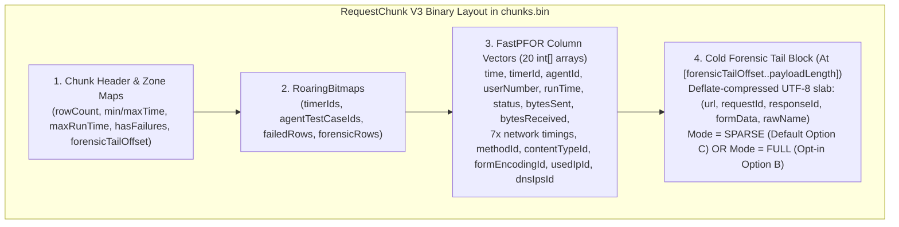
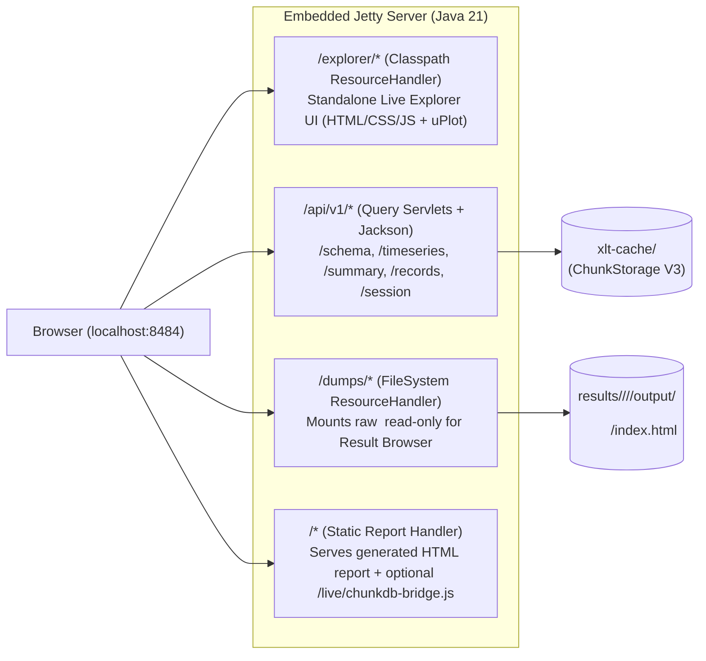

# XLT Live Reports & ChunkDB Real-Time Query Explorer (`LIVEREPORTS.md`)

> **Single Source of Truth & Architectural Reference**
>
> This document consolidates the complete architectural analysis, critical review, quantitative space/speed benchmarks (100M requests), data-completeness audit (`ChunkDB` V3), UI integration strategy with the `XLT.report-update` modernized static report prototype, and the full chronological design conversation that shaped the [`chunkdb-live-query-explorer`](../openspec/changes/chunkdb-live-query-explorer/) OpenSpec change.

---

## Table of Contents

1. [Executive Summary & Key Decisions](#1-executive-summary--key-decisions)
2. [Critical Review of Current ChunkDB (V2) for Real-Time Querying](#2-critical-review-of-current-chunkdb-v2-for-real-time-querying)
3. [Complete Data Preservation Audit: Closing Every Gap in ChunkDB V3](#3-complete-data-preservation-audit-closing-every-gap-in-chunkdb-v3)
4. [Quantitative Cost & Speed Analysis (100 Million Requests)](#4-quantitative-cost--speed-analysis-100-million-requests)
5. [Two-Speed Vectorized Query Engine & Embedded Jetty API](#5-two-speed-vectorized-query-engine--embedded-jetty-api)
6. [UI Architecture: Zero Toolchain, Static Purity & Modernized Report Alignment](#6-ui-architecture-zero-toolchain-static-purity--modernized-report-alignment)
7. [Complete Chronological Design Conversation](#7-complete-chronological-design-conversation)

---

## 1. Executive Summary & Key Decisions

With the introduction of **`ChunkDB`** (`xlt-cache/`) in `src/main/java/com/xceptance/xlt/report/storage/`, XLT already possesses an embedded, SIMD-compressed (`JavaFastPFOR` + `RoaringBitmap`) columnar data store capable of holding 100M+ rows in `< 80 MB` of JVM heap.

By upgrading `ChunkDB` to **V3 (100% lossless data preservation)** and adding a **vectorized `ColumnarQueryEngine`** served over **Embedded Jetty**, XLT evolves from a purely static post-mortem report generator into an **interactive root-cause diagnostic workbench**—without adding a single new Maven dependency or JavaScript build toolchain.

### Core Design Decisions Agreed Upon
1. **Primary Target Persona**:
   - **Human-first interactive Web UI** (`< 100 ms` query latency, fluent and fast without over-engineered 60fps gimmicks).
   - **Agent-ready by design**: Because the Web UI is powered by clean, stateless JSON endpoints (`/api/v1/schema`, `/api/v1/timeseries`, `/api/v1/summary`, `/api/v1/records`, `/api/v1/session`) and pairs with the modernized report's `📋 Copy Table as Markdown` feature, AI agents and MCP tools can consume the exact same endpoints later for free.
2. **100% Data Completeness (`ChunkDB` V3)**:
   - **Hybrid Request Forensic Tail Block (`sparse` default + `full` opt-in)**:
     - **Default `sparse` mode (Option C)**: Preserves exact `(url, requestId, responseId, formData, rawName)` for all failed/4xx/5xx requests **plus** the top-256 slowest requests per 64K chunk (`< 2%` disk overhead, `0 MB` global heap, `< 1%` ingestion cost).
     - **Opt-in `full` mode (Option B)**: Activated via `-Dcom.xceptance.xlt.report.storage.requestDetailsMode=full` or CLI `--preserve-all-details`. Preserves exact `(url, requestId, responseId, formData, rawName)` for **every single row** (`0..63,999`) inside a chunk-local Deflate-compressed UTF-8 slab (`0 MB` global dictionary heap, `0 ms` penalty on chart scans because the block sits at the cold tail of the chunk).
   - **Virtual User Instance Correlation (`compUserNumbers`)**: Stores `userNumber` (parsed from `<agent>/<testCase>/<userNumber>/timers.csv`) as a FastPFOR integer column across **all** chunk types (`R`, `T`, `A`, `C`, `P`, `W`, `V`, `E`) at `< 0.3 bytes/row`, unlocking 1-click **Virtual User Session Reconstruction**.
   - **Form Data Encoding (`formDataEncoding`)**: Interned in `GlobalDictionaries` (`compFormDataEncodings` in `RequestChunk`).
   - **Non-Failed Transaction Result Browser Dumps (`directoryName`)**: Preserved in `TransactionChunk` even when `hasFailed() == false` (for slow-transaction or `output2disk=always` dumps).
   - **Pre-Merge Request Name (`rawName`)**: Captured before `MergeRuleProcessor.postprocess()` overwrites `RequestData.name`.
   - **Catalog V3 Zone Maps**: Adds `int maxRunTime` and `boolean hasFailures` to `DiskChunk` and `catalog.idx` (`XC03`) so latency and error queries skip non-matching chunks before touching disk.
3. **Frontend & Static Report Separation**:
   - **Zero JS Build Toolchain**: Plain Vanilla ES6+ JavaScript, CSS custom properties, and a single vendored `uPlot` canvas library (`~45 KB`) in `src/main/resources/`. Zero Node.js/npm/Webpack/Parcel steps.
   - **100% Clean Default Static Reports**: Standard `create_report` produces pure static HTML/CSS/JS with **zero** live-bridge scripts or dead buttons so reports can be uploaded to external servers (S3, Jenkins, customer portals).
   - **Opt-In Live Mode (`--serve` or `--live-bridge`)**: Starts Embedded Jetty mounting the static report (`/`), the standalone `/explorer` app, `/api/v1/*`, and `/dumps/*` (for 1-click Result Browser access), and progressively enhances the modernized report (`reports/modernized-report/`) via a thin `chunkdb-bridge.js` adapter.
4. **Deferred for Later**:
   - Multi-run comparison (mounting multiple `xlt-cache/` directories simultaneously) is ignored for v1.

---

## 2. Critical Review of Current ChunkDB (V2) for Real-Time Querying

Wiring an HTTP endpoint directly to the existing batch `ChunkQueryEngine.executeScan()` would leave **5x–10x of interactive performance on the table**. Five specific architectural bottlenecks were identified and solved in the design:

### Critique 1: The "Row Reconstitution Tax" in `ChunkTypeHandler.scan()`
- **Problem**: In `RequestChunkHandler.scan()`, if even a single row in a 64,000-row chunk matches the time/timer/agent filter, lines `367–383` unconditionally decompress **all 15 remaining columns** (`dnsTimes`, `connectTimes`, `httpMethods`, `contentTypes`, `ipAddresses`, etc.) and materialize full `RequestData` POJOs into `PostProcessedDataContainer`. In an interactive chart query (e.g., plotting `runTime` and `serverBusyTime` for `Checkout`), decompressing 14 unused columns and allocating POJOs wastes ~80% of CPU and memory bandwidth.
- **Solution**: Interactive queries use `ColumnarQueryEngine`, which **never instantiates `RequestData` or touches `StatisticsProcessor`**. It accepts a `ColumnMask` and aggregates directly over the 2–4 required primitive `int[]` vectors.

### Critique 2: Eager Full-Chunk I/O in `DiskChunk.load()`
- **Problem**: `DiskChunk.load()` reads the entire `payloadLength` byte array from `chunks.bin` at once. If we append forensic strings (`url`, `requestId`, `formData`) to `RequestChunk`, chart queries would waste I/O bandwidth reading megabytes of forensic strings they never inspect.
- **Solution**: `RequestChunk` writes `int forensicTailOffset` in its chunk header. Vector scans read only `[fileOffset .. fileOffset + forensicTailOffset)` via `FileChannel`, completely skipping disk I/O for the cold Forensic Tail Block.

### Critique 3: Missing Zone Maps in `DiskChunk` for Latency & Error Queries
- **Problem**: `ScanPredicate.mayMatchChunk()` in V2 only prunes chunks by `[minTime, maxTime]`, `timerNameIds`, and `agentTestCaseIds`. Queries like *"Show me all failed requests"* or *"Show me requests with `runTime > 5000ms`"* must load and decompress 100% of chunks on disk.
- **Solution**: Add `int maxRunTime` and `boolean hasFailures` (5 bytes per chunk) to `DiskChunk` and `ChunkCatalog` (`XC03`). Filtering by `minRunTime > chunk.getMaxRunTime()` or `failedOnly && !chunk.hasFailures()` prunes 99% of chunks in microseconds before any disk read.

### Critique 4: The "Sampled URL" Illusion
- **Problem**: `GlobalDictionaries` only retains up to `MAX_SAMPLE_URLS_PER_TIMER = 5` sample URLs per timer and reconstructs URLs during batch scans via round-robin modulo indexing (`sampleUrls[i % sampleUrls.length]`). Showing a synthetic round-robin URL when an engineer inspects a specific slow or failed request in a live diagnostic tool would be actively misleading.
- **Solution**: Store exact per-row `url` (along with `requestId`, `responseId`, `formData`, `rawName`) in the **Forensic Tail Block** (`sparse` for all errors + top-256 slowest per chunk by default, or `full` for all 64,000 rows when `--preserve-all-details` is enabled).

### Critique 5: Avoiding the SQL Parser / Calcite Trap
- **Problem**: Embedding Apache Calcite or H2 bloats the distribution, forces SIMD vectors through row-oriented `ResultSet` iterators, and makes time-series bucketing + `KllFloatsSketch` percentile merging awkward.
- **Solution**: Keep the query contract as a clean, typed JSON filter/aggregation specification mapped 1:1 to `ChunkDB` vectors and `RoaringBitmap` indices.

---

## 3. Complete Data Preservation Audit: Closing Every Gap in ChunkDB V3

Every `Data` subclass (`RequestData`, `TransactionData`, `ActionData`, `PageLoadTimingData`, `CustomData`, `WebVitalData`, `CustomValue`, `EventData`) and every `ChunkTypeHandler` was audited against the raw `timers.csv` columns. Exactly **4 gaps** existed in V2:

| Gap # | Record Type(s) | Dropped Field(s) in V2 | Why It Matters for Live Diagnostics | ChunkDB V3 Solution & Storage Cost |
| :--- | :--- | :--- | :--- | :--- |
| **Gap 1** | `RequestData` (`'R'`) | 1. Exact `url` (col 8) 2. `requestId` (col 16) 3. `responseId` (col 22) 4. `formDataEncoding` (col 18) 5. `formData` (col 19) | Needed to correlate slow/failed HTTP calls with backend APM/logs (`requestId`/`responseId`) and inspect exact URL query params or POST bodies (`formData`) that triggered a `500` error. | - `formDataEncoding`: Interned in `GlobalDictionaries` + `compFormDataEncodings` (`FastPFOR`). - `(url, requestId, responseId, formData, rawName)`: Stored in cold **Forensic Tail Block** (`sparse` default: `<30 MB` / 100M rows; `full` opt-in: `+2.5–4.5 GB`). |
| **Gap 2** | Non-Transaction records (`'R'`, `'A'`, `'C'`, `'P'`, `'W'`, `'V'`, `'E'`) | `userNumber` (from `<agent>/<testCase>/<userNumber>/timers.csv`) | In V2, `userNumber` was only set on `TransactionData`. Without `userNumber` on Actions, Requests, and Events, you cannot reconstruct a single Virtual User's session waterfall around a failure. | Parse integer `userNumber` once per user folder in `DataParserThread` and store `compUserNumbers` (`FastPFOR`) across all chunk types. Because files are read per user directory, consecutive rows share the same ID (**`< 0.3 bytes/row`**, ~25 MB per 100M rows). |
| **Gap 3** | `TransactionData` (`'T'`) | `directoryName` (col 8) when `hasFailed() == false` | When XLT is configured to dump result browsers on slow transactions or unconditionally (`output2disk = always`), `directoryName` is present on non-failed transactions but was ignored by `TransactionChunkHandler`. | Store `directoryName` in `TransactionChunk`'s sparse diagnostics map whenever `td.hasFailed() \|\| (td.getDirectoryName() != null && !td.getDirectoryName().isEmpty())`. Cost: **0 bytes** unless non-failed dumps exist. |
| **Gap 4** | `RequestData` (`'R'`) | Pre-merge `rawName` (col 1 before `MergeRuleProcessor.postprocess()`) | If an overly broad request merge rule buckets distinct endpoints into one timer name, the original unmerged request name was lost. | Capture `reqData.setRawName(reqData.getName())` before `requestProcessing.postprocess()` and store `rawName` in the Forensic Tail Block whenever it differs from the merged timer name. |

---

## 4. Quantitative Cost & Speed Analysis (100 Million Requests)

Benchmarking a large **100M request** load test (`~1,560` chunks of 64,000 rows each):

| Strategy | Disk Cost (`chunks.bin` + `dictionaries.bin`) | JVM Heap Cost | Pass 1 Ingestion Speed Impact | Chart / Time-Series Query Speed Impact |
| :--- | :--- | :--- | :--- | :--- |
| **V2 Baseline** (5 sample URLs/timer, no ReqID) | **~1.2 – 1.8 GB** (~15 bytes/row) | **< 80 MB** | **Baseline (1.0x)** | **Baseline** |
| **Option A: Naive Global Interning** (All URLs & ReqIDs in `GlobalDictionaries`) | **+8 to +18 GB** | **OOM (> 12 GB RAM)** (~112 bytes/entry in `ConcurrentHashMap`) | **3x – 5x slower** (HashMap & GC thrashing) | Unaffected unless scanned |
| **Option B (`full` mode): Chunk-Local Compressed String Slab** (100% exact for all 64k rows/chunk, zero global heap) | **+2.5 to +5.0 GB** (+25–50 bytes/row) | **< 95 MB** (+15 MB transient buffer) | **~15% – 25% slower** (UTF-8 copy + Deflate) | **Zero impact (0 ms)** — skipped via `forensicTailOffset` |
| **Option C (`sparse` default): Sparse Outlier & Failure Preservation** (100% exact for errors + top-256 slowest/chunk) | **+15 to +60 MB** (< 2% increase) | **< 82 MB** (~0 MB increase) | **< 1% slower** (Noise floor) | **Zero impact (0 ms)** — skipped via `forensicTailOffset` |

### `RequestChunk` V3 Binary Layout

---

## 5. Two-Speed Vectorized Query Engine & Embedded Jetty API

All dependencies are already present in [`pom.xml`](../pom.xml):
- `org.eclipse.jetty:jetty-servlet:9.4.57.v20241219`
- `com.fasterxml.jackson.core:jackson-databind:2.18.3`
- `me.lemire.integercompression:JavaFastPFOR:0.1.12`
- `org.roaringbitmap:RoaringBitmap:1.3.0`
- `org.apache.datasketches:datasketches-java:7.0.1` (`KllFloatsSketch`)

### Serving Architecture (`ChunkDbQueryServer`)

### REST API Endpoints
1. **`GET /api/v1/schema` (`< 2 ms`)**:
   - Reads directly from in-memory `GlobalDictionaries` and `ChunkCatalog`.
   - Returns global `minTime`, `maxTime`, `totalRowCount` per type, `forensicMode` (`sparse` or `full`), and all interned `timerNames`, `agents`, `scenarios`, `httpMethods`, `contentTypes`, `formDataEncodings`, and `usedIps`.
2. **`POST /api/v1/timeseries` (`10 – 80 ms` on 100M rows)**:
   - Prunes chunks via `ScanPredicate` + V3 Zone Maps (`maxRunTime`, `hasFailures`).
   - Reads only `[0 .. forensicTailOffset)` from matching chunks and decompresses only the 2–4 requested `int[]` columns.
   - Dynamically buckets matching rows into `100ms`, `1s`, `5s`, `10s`, `60s`, or `auto` buckets (returning columnar arrays ready for `uPlot`: timestamps, count, errors, mean, min, max, `p50`, `p90`, `p95`, `p99`, network sub-timings, or group-by series).
3. **`POST /api/v1/summary` (`10 – 50 ms`)**:
   - Computes exact-feel percentiles (`P50`, `P90`, `P95`, `P99`, `P99.9`), latency histograms, and group-by breakdowns (`Timer`, `Used IP`, `Agent`, `Scenario`, `Status Code`, `Content-Type`) by merging thread-local `KllFloatsSketch` instances across `ForkJoinPool` workers. Also supports recomputing the `window.ALL_REQUESTS` table for any brushed time window.
4. **`POST /api/v1/records` (`5 – 30 ms`)**:
   - Returns the top-N slowest or failed individual rows in the selected window, decoding the Forensic Tail Block only for matching `(chunkIndex, rowIndex)` pairs to populate `url`, `rawName`, `requestId`, `responseId`, `formData`, `formDataEncoding`, `usedIpAddress`, `userNumber`, and network phase timings.
5. **`GET /api/v1/session` (`5 – 20 ms`)**:
   - Queries across `T`, `A`, `R`, `C`, `P`, `E` chunks for `(agentId, transactionNameId, userNumber, fromTime, toTime)` using `compUserNumbers` and returns the chronological Virtual User execution waterfall plus any `directoryName` link to `/dumps/*`.

---

## 6. UI Architecture: Zero Toolchain, Static Purity & Modernized Report Alignment

### 6.1 Inspecting the `XLT.report-update` Prototype (`reports/modernized-report/`)
The modernized static report prototype in [`reports/modernized-report/`](../reports/modernized-report/) establishes XLT's new visual and technical direction:
- **Zero-dependency static files** (`index.html`, `transactions.html`, `actions.html`, `requests.html`, `network.html`, `errors.html`, `agents.html`, `configuration.html`).
- **Design System (`css/style.css`)**: CSS custom properties (`--bg-primary`, `--bg-surface`, `--brand-blue`, `--font-mono`, `--border-subtle`), dark/light mode (`js/theme.js`), tabular monospace numerals, inline mini-waterfalls, and latency pills.
- **Sticky Chart Workbench (`#chart-workbench`)**: Top pageable workbench synchronized with table row selection and keyboard navigation (`←`/`→` for charts, `↑`/`↓` for rows, `Enter` for inline drawer).
- **Client-Side Data Model (`window.ALL_REQUESTS` in `js/requests-data.js`)**: Drives instant client-side filtering, category chips, and multi-column sorting.
- **Inline Expandable Row Drawers (`#drawer-${item.id}`)**: Expands beneath any row to show percentiles and network timings.
- **Agentic Markdown Export (`table-copy-markdown.js`)**: `📋 Copy Table as Markdown` button on tables.

### 6.2 Protecting Against Ongoing Prototype Changes: Two-Part UI Strategy
Because the modernized static report is still an evolving prototype, our UI architecture is split into two cleanly separated parts:

1. **Standalone `/explorer` App (`src/main/resources/com/xceptance/xlt/report/explorer/`)**:
   - Self-contained diagnostic workbench (`explorer.html`, `explorer.css`, `explorer.js`, plus vendored `uplot.iife.min.js` and `uplot.min.css`).
   - Reuses the exact CSS variables and dark/light theme from `reports/modernized-report/css/style.css`.
   - Provides the **3-step diagnostic funnel** (**Spot $\rightarrow$ Isolate $\rightarrow$ Reconstruct**):
     - **Spot**: Global timeline brush & zoom (`uPlot`) with automatic resolution sharpening (`60s` $\rightarrow$ `5s` $\rightarrow$ `1s` $\rightarrow$ `100ms`), percentile bands, and stacked network timings.
     - **Isolate**: Live `Group By` dimension switcher (`None`, `Timer Name`, `Used IP`, `Agent`, `Scenario`, `HTTP Status`, `Content-Type`).
     - **Reconstruct**: Bottom Forensic Outlier & Failure Inspector table with exact `url`, `requestId`, `responseId`, `formData`, and 1-click **Virtual User Session Waterfall** modal + `/dumps/*` Result Browser links.
   - **Zero coupling to static report DOM changes**: Works on any `xlt-cache/` directory even if no HTML report was generated (`--query-only`).

2. **Optional Static Report Bridge (`chunkdb-bridge.js`)**:
   - **Never** included in normal `create_report` runs so static reports remain 100% pure for uploading to external servers.
   - Included **only** when served via `create_report --serve` or explicitly requested via `--live-bridge`.
   - Progressively enhances the modernized report when `/api/v1/schema` responds:
     - **Global Time-Window & Dimension Slicer**: Recomputes `window.ALL_REQUESTS` for any selected time slice, agent, or backend IP in `< 50 ms`, updating all existing tables, KPI chips, and `📋 Copy Markdown` exports in place.
     - **Live Tab in `#chart-workbench`**: Adds a `🔬 Live Breakdown (ChunkDB)` tab inside `.chart-tabs` for dynamic resolution zooming and IP/Agent/Status splitting.
     - **Forensic Samples in `#drawer-${item.id}`**: Appends a live Forensic Outliers & Errors card with `[👤 Trace User #42]` session replay buttons when a row drawer is expanded.

---

## 7. Complete Chronological Design Conversation

Below is the complete record of the architectural Q&A and design iterations from this session.

---

### Turn 1 — Initial Concept, Inspiration & Critical Review

**User:**
> With our new approach of data presevation (ChunkDB), we suddently have the opportunity to add a real time query, filter, and charting endpoint that allows us to dig deeper into the data.
>
> Think about that possibility and how such an query tool might look like. Java prefered so it fits the current flexible tool stack.
>
> Propose, suggest, inspire and review the idea critically. Do not implement!

**Assistant:**
With [`ChunkStorage`](../src/main/java/com/xceptance/xlt/report/storage/ChunkStorage.java) and [`ChunkCatalog`](../src/main/java/com/xceptance/xlt/report/storage/catalog/ChunkCatalog.java), you have already built an embedded, SIMD-compressed columnar OLAP store (`xlt-cache/`). Until now, it has only been used to speed up **batch report generation** via [`ChunkQueryEngine`](../src/main/java/com/xceptance/xlt/report/ChunkQueryEngine.java).

Exposing `ChunkDB` through a real-time query, filter, and charting endpoint turns XLT from a **static post-mortem report generator** into an **interactive root-cause diagnostic engine**.

#### 1. Vision & Inspiration: What Does This Unlock?
Static HTML reports force you to decide *before* running the report generator what time window, merge rules, and aggregations you care about. When you spot a spike at `14:23:10`, the static report hits a wall:
- **Sub-Second Brush & Zoom (Dynamic Resolution)**: Instead of looking at a 6-hour chart with 1-minute buckets—or waiting minutes to regenerate a sliced report—you drag-select a 45-second anomaly window and immediately re-bucket [`IntTimeSeries`](../src/main/java/com/xceptance/xlt/report/util/IntTimeSeries.java) at **100ms resolution**.
- **Multi-Dimensional Slicing ("Why did `Checkout` slow down?")**: Filter `timerName = 'PlaceOrder'` and `runTime > 3000ms`, then group by `usedIpAddress` (which backend server?), `agentName` (which load generator?), or `responseCode`. You immediately see that 95% of slow requests hit a single backend IP or came from one choked load agent.
- **Latency Heatmaps Instead of Summary Lines**: Because [`RuntimeHistogram`](../src/main/java/com/xceptance/xlt/report/util/RuntimeHistogram.java) and `org.apache.datasketches` are already in [`pom.xml`](../pom.xml), the endpoint can return time-bucketed latency distributions (2D heatmaps) that reveal bimodal latency (e.g., fast cache hits vs. slow DB misses) which mean/median lines hide.
- **Network Phase Decomposition on Demand**: Dynamically stack or compare `dnsTime`, `connectTime`, `sendTime`, `serverBusyTime`, and `receiveTime` for only failed or p99 requests.
- **AI / MCP Diagnostic Endpoint**: An LLM or automated CI gate can query the JSON endpoint directly (*"Find the top 3 timers whose p99 degraded most during the 14:20 error burst and check if they correlate with a specific target IP"*) without parsing multi-megabyte HTML/XML files.

#### 2. Proposed Architecture (Zero New Dependencies)
Your [`pom.xml`](../pom.xml) **already contains every single building block needed**:
- **HTTP Server**: Eclipse Jetty (`jetty-servlet` `9.4.57`)
- **JSON Serialization**: Jackson (`jackson-databind` `2.18.3`)
- **Terminal REPL**: JLine 3 (`jline` `3.29.0`)
- **Analytics Primitives**: `RoaringBitmap`, `JavaFastPFOR`, `datasketches-java`, `IntTimeSeries`, `RuntimeHistogram`

#### 3. Critical Review Summary
1. **Critique 1**: Eliminate the "Row Reconstitution Tax" in `ChunkTypeHandler.scan()` via selective columnar projection and primitive `int[]` vector aggregation.
2. **Critique 2**: Avoid eager full-chunk I/O in `DiskChunk.load()` by storing column/tail offsets.
3. **Critique 3**: Add Zone Map metadata (`int maxRunTime`, `boolean hasFailures`) to `DiskChunk` so latency and error queries skip 99% of chunks without disk I/O.
4. **Critique 4**: Solve the "Sampled URL" illusion (`MAX_SAMPLE_URLS_PER_TIMER = 5`) by preserving exact URLs for outlier/failed rows (or via an opt-in flag).
5. **Critique 5**: Avoid heavy SQL parsers (Calcite/H2) in favor of a native JSON OLAP query contract over `ChunkDB` vectors.

#### Questions Asked to Shape Direction:
1. **Primary Persona & Workflow**: Interactive web UI, headless API/CLI for agents, or both?
2. **Drill-Down Depth**: Should we preserve exact URLs / request IDs for outlier & failed rows during Pass 1 ingestion?
3. **Multi-Run Comparison**: Mount two or more `ChunkStorage` directories simultaneously?

---

### Turn 2 — Exact Space/Speed Costs & Human-First Web UI Design

**User:**
> # questions
> 3. ignore for now
> 2. how much would that cost in terms of space, speed, and so on aka exakt data
> 1. more of a human web ui, later maybe also an agent interface, depends on speed and scale

**Assistant:**
Detailed the exact cost across 100M requests (`~1,560` chunks of 64,000 rows) for:
- **Current Baseline**: `~1.2 – 1.8 GB` disk, `< 80 MB` heap.
- **Option A (Naive Global Interning in `GlobalDictionaries`)**: `+8 to +18 GB` disk, **OOM (`> 12 GB` heap)** because 100M unique `requestId` strings in `ConcurrentHashMap<String, Integer>` cost ~112 bytes of uncollectable heap per entry (`11.2 GB`), and `3x–5x` slower Pass 1 ingestion.
- **Option B (Chunk-Local Compressed String Slab — 100% exact for every row)**: `+2.5 to +5.0 GB` disk (`+25–50 bytes/row`), `< 95 MB` heap (`+15 MB` transient chunk buffer), `~15%–25%` slower Pass 1 ingestion, and **zero impact on chart query speed** because the compressed slab is placed at the end of the chunk payload and skipped during metric scans.
- **Option C (Sparse Outlier & Failure Preservation — 100% exact for errors + top-256 slowest per chunk)**: `+15 to +60 MB` disk (`< 2%` increase), `~0 MB` heap increase, `< 1%` ingestion impact, and **zero query speed impact**.

Proposed the **"Two-Speed" Query Engine** (`/metadata`, `/timeseries`, `/inspect`) and the **Human Web UI ("XLT DeepDive")** workbench with a global timeline scrubber, group-by dimension switcher, and bottom forensic outlier inspector linking directly to the XLT Result Browser.

---

### Turn 3 — Complete Audit of All Dropped Data Across All Chunk Types

**User:**
> Option C with the Option B flag when desired sounds nice.
> add what we drop to make it complete
>
> I like your concept for the human part

**Assistant:**
Audited all 8 record types (`R`, `T`, `A`, `C`, `P`, `W`, `V`, `E`) against `timers.csv` and identified all **4 data gaps**:
1. **Gap 1 (`RequestData` `'R'`)**: `url`, `requestId`, `responseId`, `formDataEncoding`, `formData`.
2. **Gap 2 (`userNumber` on non-Transaction records)**: `DataReaderThread` passes `userNumber` (from `<agent>/<testCase>/<userNumber>/timers.csv`) to `DataParserThread.applyDataAdjustments()`, which previously only saved it on `TransactionData` and discarded it for `RequestData`, `ActionData`, `PageLoadTimingData`, `CustomData`, `WebVitalData`, `CustomValue`, and `EventData`. Storing `compUserNumbers` (`FastPFOR`) across all chunk types costs `< 0.3 bytes/row` (`~25 MB` for 100M rows) and unlocks **1-Click Virtual User Session Reconstruction**.
3. **Gap 3 (`TransactionData` `'T'` non-failed `directoryName`)**: `TransactionChunkHandler` previously only stored `directoryName` when `td.hasFailed() == true`, dropping Result Browser dump links when `output2disk = always` or on slow non-failed transactions.
4. **Gap 4 (Pre-merge `RequestData` `rawName`)**: `MergeRuleProcessor.postprocess()` overwrote `RequestData.name`. Capturing `rawName` before merge rules preserves the original unmerged timer name.

Defined the **3-step diagnostic funnel** for the Web UI: **1. Spot (Timeline & Heatmap) $\rightarrow$ 2. Isolate (Dimension Split) $\rightarrow$ 3. Reconstruct (Forensic Drawer & Virtual User Session Trace)**.

---

### Turn 4 — How to Build the UI (Zero External Servers, Low Maintenance)

**User:**
> how do we build the UI

**Assistant:**
Reviewed [`build.xml`](../build.xml), [`ant-scripts/resultbrowser.xml`](../ant-scripts/resultbrowser.xml), and [`resultbrowser/package.json`](../resultbrowser/package.json) and presented:
1. **Serving Layer**: Embedded Jetty (`jetty-servlet` + `jackson-databind` already in `pom.xml`) mounting:
   - `/` or `/explorer`: Classpath `ResourceHandler` serving the UI assets directly from `xlt.jar`.
   - `/api/v1/*`: Query servlets backed by `ChunkStorage`.
   - `/dumps/*`: Read-only `FileSystem` `ResourceHandler` mounting `<results-dir>` so clicking "Open Result Browser" opens `/dumps/<agent>/<tx>/<user>/output/<dir>/index.html` without `file://` CORS issues.
2. **Frontend Options Ranked**:
   - **Option 1 (Recommended)**: Zero-Build Vanilla ES Modules + vendored `uPlot` (`~45 KB`) directly in `src/main/resources/` (zero Node.js/npm build step, instant `F5` reload, zero dependency rot).
   - **Option 2**: Preact + TypeScript bundled via Ant/npm (like `resultbrowser`).
   - **Option 3**: Server-side HTML fragments (HTMX).
3. **Section 5 — Bridging Static Reports and the Live UI**: Using `create_report --serve <results-dir>` to serve both the static HTML report and the live `ChunkDB` explorer so users can jump straight from static summary tables into live high-resolution slicing.

---

### Turn 5 — Pragmatic Performance, No JS Toolchain & Progressive Enhancement

**User:**
> 60 fps... we don't need that. fluent and fast yes, but that it over the top
> yes, no JS tool chain. other than that, make it work and
> i find 5) very appealing

**Assistant:**
Refined the design around **"Static by Default, Live When Served"** with zero JS build toolchain:
- Plain Vanilla JS + vendored `uPlot.iife.min.js` + plain CSS in `src/main/resources/`.
- Outlined three progressive enhancements inside the report (`Interactive Chart Toggle`, `Forensic Inspector Drawer`, and `1-Click Virtual User Session Trace & Result Browser`).

---

### Turn 6 — Clean Static Reports for Upload & Alignment with `XLT.report-update` Prototype

**User:**
> regular static reports only get optionally the bridge, because we might produce them ofr uploading to other server
> important, we have a report upgrade project in the making: /home/rschwietzke/projects/GIT/XLT.report-update
>
> only a prototype at the moment, but that is the direction. so, the base report concept will change (stay static!) but be nicer, faster and offer some live changes aka switches and in place search

**Assistant:**
Inspected the modernized static report prototype in [`reports/modernized-report/`](../reports/modernized-report/) (`index.html`, `requests.html`, `errors.html`, `js/requests-data.js`) and aligned the architecture:
1. **Strict Separation**:
   - Standard `create_report <results-dir>` generates the pure static report with **zero** bridge scripts or dead buttons so it can be uploaded cleanly to any external server.
   - Only `create_report --serve <results-dir>` or `--live-bridge` activates `chunkdb-bridge.js`.
2. **Direct Integration with `modernized-report` Concepts**:
   - **Integration 1 ("Time-Slice the Entire Report")**: Recomputes `window.ALL_REQUESTS` on the fly for any brushed time window, agent, or backend IP in `< 50 ms`, feeding directly into the prototype's existing `applyFilters()`, `sortTable()`, `renderAllRows()`, `updateWorkbench()`, and `📋 Copy Table as Markdown`.
   - **Integration 2 (Live Tab in `#chart-workbench`)**: Adds `🔬 Live Breakdown (ChunkDB)` to `.chart-tabs` inside the sticky workbench.
   - **Integration 3 (Forensic Outliers in `#drawer-${item.id}`)**: Populates exact `url`, `requestId`, `responseId`, `formData`, `usedIpAddress`, and `[👤 Trace User #42]` inside the inline expandable row drawer.
   - **Integration 4 (Virtual User Session Modal & `/dumps/*`)**: Opens the chronological user waterfall modal and links `.btn-dump` directly to `/dumps/*`.

---

### Turn 7 — Implementation Planning & Decoupling from Prototype Churn

**User:**
> ok let's do the planning for implementation. our new reports are still half prototypes, some things might still change. hope that is ok, if so, we might want to continue this from here

**Assistant:**
Created the full OpenSpec planning artifacts in [`openspec/changes/chunkdb-live-query-explorer/`](../openspec/changes/chunkdb-live-query-explorer/) (`proposal.md`, `design.md`, `specs/chunkdb-live-query-explorer/spec.md`, `tasks.md`), structuring Phase 3 so the standalone `/explorer` UI is 100% independent of ongoing HTML changes in the static report prototype, while `chunkdb-bridge.js` acts as a thin, isolated progressive-enhancement adapter.
