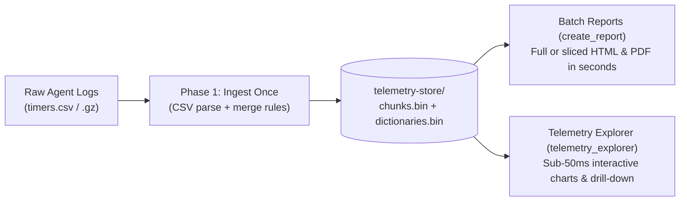
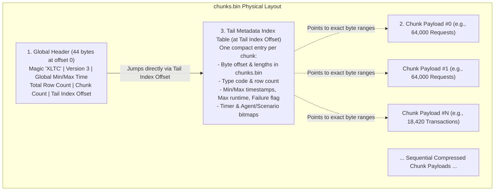
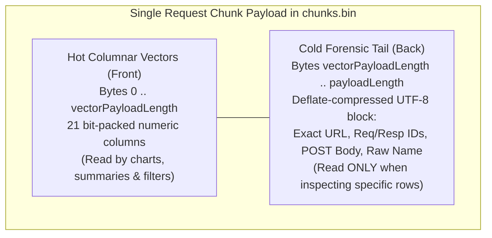
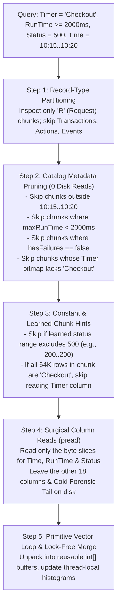

# TelemetryStore: Storage Concept & Architecture Guide

**TelemetryStore** is XLT's embedded columnar storage engine. It sits between the raw `timers.csv` agent logs and the two tools that read them: the batch report generator (`create_report`) and the interactive web workbench (`telemetry_explorer`).

This document explains how the store is laid out on disk, why it separates numbers from strings, and how it scans hundreds of millions of rows on a normal laptop without running out of RAM.

---

## Table of Contents

1. [The Problem with Raw CSV Logs](#1-the-problem-with-raw-csv-logs)
2. [Cold Runs, Warm Runs, and Cache Invalidation](#2-cold-runs-warm-runs-and-cache-invalidation)
3. [On-Disk Layout: Logical Chunks in One File](#3-on-disk-layout-logical-chunks-in-one-file)
4. [Inside a Chunk: Columns, Dictionaries, and Bit-Packing](#4-inside-a-chunk-columns-dictionaries-and-bit-packing)
5. [Hot Metrics vs. Cold Forensics](#5-hot-metrics-vs-cold-forensics)
6. [Time Series Without Sorting](#6-time-series-without-sorting)
7. [How Queries Avoid Work](#7-how-queries-avoid-work)
8. [CLI Usage & Configuration](#8-cli-usage--configuration)

---

## 1. The Problem with Raw CSV Logs

A large load test produces **50 million to 500+ million records** across tens of thousands of `timers.csv.gz` files. Reading those files directly into report generators causes two practical problems.

First, memory runs out. Turning 100 million CSV lines into Java objects takes more than 25 GB of heap. Even in a streaming pipeline, keeping file buffers, string lookup tables, and report accumulators in memory at the same time pushes a standard 4 GB JVM (`-Xmx4g`) into heavy garbage collection or `OutOfMemoryError`.

Second, analysis is rarely a single run. You generate a report, spot a ramp-up dip, re-run with `-noRampUp`, zoom into a 10-minute spike with `-from` and `-to`, filter down to one agent cluster, or click around in an interactive chart to inspect `502` responses. If the tool only knows how to stream CSVs, every single adjustment means gunzipping, splitting, parsing, and regex-matching gigabytes of text from scratch. On a big run, that costs 5 to 15 minutes each time.

TelemetryStore parses the CSV files once, writes the normalized data into a binary store (`telemetry-store/`), and runs all subsequent queries against that store.



On disk, a record takes about **15 to 22 bytes** (roughly 2 GB per 100 million rows, down from 200–500 bytes per line in CSV). During queries, the storage layer uses **under 100 MB of heap** even when scanning half a billion rows across all CPU cores.

---

## 2. Cold Runs, Warm Runs, and Cache Invalidation

By default, TelemetryStore writes its files into `<results-dir>/telemetry-store/`. You don't have to manage this folder manually.

### Cold Run: Separating Ingestion from Aggregation

When you run `create_report` on a fresh results directory, it splits the job into two phases that never share the heap:

1. **Phase 1 (Ingest and Spool)**:
   Worker threads read the raw CSV files, run request-merge and labeling rules, intern repeated strings into IDs, and pack records into 64,000-row blocks called *chunks*. When a chunk fills up, background threads compress it and append it to `chunks.bin`. Once the bytes hit disk, the chunk's arrays are recycled for the next batch. Report providers and chart accumulators aren't even allocated yet. Whether the test has 10 million rows or 500 million, Phase 1 memory stays flat under 150 MB.
2. **Phase 2 (Scan and Aggregate)**:
   After `chunks.bin` and `dictionaries.bin` are finished, the CSV reader buffers and temporary ingestion maps are dropped. Only then does the query engine scan the binary chunks and feed the report providers to build charts, XML, HTML, and PDFs.

Keeping these two phases separate is what lets a 100M+ row run finish inside a 4 GB heap without full-GC pauses.

If you start `telemetry_explorer` on a fresh results directory instead of `create_report`, it runs Phase 1 to create `telemetry-store/` and starts the web server right away. It skips Phase 2 HTML and chart rendering completely.

### Warm Run

On the next run against the same folder, Phase 1 is skipped. Re-running `create_report` with `-noRampUp`, `-from +15m -l 1h`, agent filters (`-ai`), or different Apdex settings reads directly from `telemetry-store/` and finishes in seconds. Starting `telemetry_explorer` on an existing store takes less than a second.

### How `fingerprint.bin` Detects Changes

A cache is worse than useless if it quietly serves stale numbers after you change a config rule. When Phase 1 finishes writing `telemetry-store/`, the last thing it writes is `fingerprint.bin`. That file records:

* **Input file state**: The number of timer CSV files, their combined byte count, and the newest file modification timestamp (`mtime`) across all agent directories.
* **Rule & mode hash**: A SHA-256 hash of all request-merge rules, labeling rules, request-index stripping (`removeIndexesFromRequestNames`), and the forensic retention mode (`sparse` vs. `full`).
* **Versions**: The binary storage format version (currently `3`) and the XLT release version.

On startup, TelemetryStore walks the directory tree, hashes the current configuration, and compares the result to `fingerprint.bin`. If you changed a regex in `reportgenerator.properties`, added another agent folder, upgraded XLT, or passed `--preserve-all-details`, the fingerprint mismatches. TelemetryStore deletes `telemetry-store/` and rebuilds it from the raw CSVs.

> [!TIP]
> **Sharing a store without raw logs**: You can point `telemetry_explorer` directly at a `telemetry-store/` directory instead of the parent results folder. When pointed straight at `telemetry-store/`, it mounts `chunks.bin` and `dictionaries.bin` directly and doesn't need the original `.csv.gz` files on disk.

---

## 3. On-Disk Layout: Logical Chunks in One File

A `telemetry-store/` directory contains three files:

```text
<results-dir>/telemetry-store/
├── chunks.bin          # Compressed columnar chunks + tail index table
├── dictionaries.bin    # Interned string tables & sample URLs
└── fingerprint.bin     # Input & config fingerprint for cache validation
```

### Logical Chunks

Incoming records are separated by type code:
* `R`: HTTP Requests (usually over 90% of all records)
* `T`: Transactions (end-to-end user scenarios)
* `A`: Actions (page steps inside transactions)
* `P` and `C`: Page Load Timings and Custom Timers
* `W` and `V`: Core Web Vitals and Custom Values (floating-point metrics)
* `E`: Application Events
* Custom types: Any custom `Data` subclass logged by test code is handled automatically by a generic columnar fallback codec.

Within each type, records are buffered into chunks of up to **64,000 rows**. That size is deliberate. FastPFOR integer compression works on blocks of 128 values ($64,000 = 500 \times 128$). An unpacked 64K `int[]` array is 256 KB, which fits in L2/L3 cache on a single core. And at the catalog level, one chunk needs only ~80 bytes of metadata in RAM, so 8,000 chunks (over 500 million rows) take less than 700 KB of catalog memory.

### Why Everything Goes into a Single `chunks.bin`

At 500 million rows, 64,000 rows per chunk produces about 8,000 chunks. Writing 8,000 separate files creates unnecessary filesystem overhead: directory lookups slow down, copying the folder takes forever, and concurrent readers run into OS file-descriptor limits (`ulimit -n`).

Packing all chunks sequentially into one `chunks.bin` file fixes that:

1. **Sequential disk writes**: During ingestion, sealed chunks are appended straight to the end of `chunks.bin`. Disk I/O stays sequential.
2. **Concurrent `pread` without locks**: When mounting the store, TelemetryStore opens a single read-only `FileChannel` to `chunks.bin`. Worker threads read chunks (or individual column slices) using positional reads (`FileChannel.read(ByteBuffer, position)`), which map to OS `pread` calls. Positional reads don't touch a shared file offset and don't lock each other out. Sixteen or 32 threads can read different parts of `chunks.bin` at the same time through one file descriptor.

### Why the Index Sits at the End of the File



While Phase 1 is streaming logs, it doesn't know how many chunks the test will produce or how large each compressed chunk will be. Writing the index at the end of `chunks.bin` avoids having to pre-calculate offsets or rewrite the file:

1. Reserve 44 bytes at byte `0`.
2. Append compressed chunk payloads one after another, keeping an 80-byte descriptor per chunk in memory.
3. After the last chunk is written, write all chunk descriptors as the **Tail Metadata Index Table** at the current end of the file (`metadataIndexOffset`).
4. Seek back to byte `0` and write the 44-byte header containing `metadataIndexOffset`.

When a warm run mounts `chunks.bin`, it reads the 44 bytes at offset `0`, seeks directly to `metadataIndexOffset`, and reads the entire index table into memory in a couple of milliseconds.

---

## 4. Inside a Chunk: Columns, Dictionaries, and Bit-Packing

### Row Layout vs. Column Layout

In a CSV file or row-oriented database, all fields of one event sit next to each other:

```text
Row 1: [10:00:01.102, "Homepage", "Agent1/TBrowse", 142ms, 200, 512B, 48120B, "GET", "text/html", ...]
Row 2: [10:00:01.105, "Search",   "Agent2/TSearch",  89ms, 200, 610B, 12400B, "GET", "application/json", ...]
```

If you only want to plot response times over time, a row store still has to read and step past byte counts, status codes, HTTP methods, MIME types, IP addresses, and URLs on every row just to grab the timestamp and the `142ms` runtime.

Inside a TelemetryStore chunk, the layout is flipped. An HTTP request chunk stores **21 separate arrays**, each up to 64,000 elements long:

```text
Column 0 (Time Offsets):  [0, 3, 11, 19, 24, ...]
Column 1 (Timer IDs):     [0, 1, 0, 2, 1, ...]
Column 2 (Agent/Test IDs):[4, 7, 4, 4, 7, ...]
Column 3 (RunTimes ms):   [142, 89, 138, 910, 76, ...]
Column 4 (Status Codes):  [200, 200, 200, 500, 200, ...]
Columns 5..20:            [Bytes Sent/Recv, 7 Network Sub-Timings, Method, MIME, IPs, User#, Encoding, URL Hash]
```

Storing values by column helps in two ways. First, a query that only needs timestamps and runtimes reads just those two columns and leaves the other 19 on disk. Second, like values sit together. A row mixes timestamps, text, and byte counts, which compresses poorly. A column of 64,000 HTTP status codes (`200, 200, 200...`) or 64,000 small timer IDs has almost no entropy and packs down to a few bits per row.

### String Interning (`dictionaries.bin`)

Most strings in load test logs repeat millions of times: timer names (`"OpenHomepage"`, `"AddToCart"`), agent names, scenario names, HTTP methods (`"GET"`, `"POST"`), MIME types (`"application/json"`), server IPs, and recurring event/error messages.

TelemetryStore stores each unique string once in **`dictionaries.bin`** and hands out a sequential 16-bit integer ID (`0, 1, 2, ...`). Agent name and scenario name are interned together as a single `(agent, scenario)` pair ID because filters frequently check both at once. The dictionary also keeps up to 5 sample URLs per timer ID so batch reports can show example URLs without scanning raw request records.

### Delta Timestamps and FastPFOR Bit-Packing

Once repeated strings are turned into integer IDs, all 21 columns in a request chunk are integer arrays. Storing them as plain 32-bit or 64-bit integers would still waste space:

* **Offsets from `minTime`**: A full epoch timestamp takes 64 bits (`1760191201102`). Since the chunk header already stores the chunk's earliest timestamp (`minTime`), column 0 only stores `rowTime - minTime`. Within a chunk, those millisecond offsets are small positive numbers.
* **FastPFOR 128-value bit-packing**: Each integer column is broken into 128-element blocks and packed to the smallest bit width that fits the block. If 128 timer IDs fall between `0` and `15`, each value uses **4 bits** instead of 32. If 127 response times in a block are under `250 ms` (8 bits) and one request spikes to `15,000 ms` (14 bits), FastPFOR doesn't widen all 128 slots to 14 bits. It packs the block at 8 bits and stores the single `15,000 ms` outlier in a small side exception list.

Because 128-integer bit-unpacking maps onto CPU SIMD instructions, a single core can decompress tens of millions of integers per second.

---

## 5. Hot Metrics vs. Cold Forensics

HTTP request telemetry has two very different kinds of fields:

* **Numbers and IDs**: Timestamps, runtimes, network phase timings, status codes, byte counts, and dictionary IDs. Every chart, percentile, and summary table needs these.
* **Per-request forensic strings**: The full URL with its unique query parameters, `requestId`, `responseId`, `POST` form data, and the original `rawName` before merge rules rewrote it. Nothing in a chart or summary table touches these strings, but when you are debugging a 14-second outlier or an `HTTP 500`, they are the exact details you need.

Putting unique URLs and POST bodies inline with the numeric columns bloats the file and slows down scans. Dropping them breaks root-cause debugging.

### Splitting Each Request Chunk in Two

TelemetryStore keeps both by dividing every request chunk payload into two sections:



1. **Hot Columnar Vectors (Front)**: Bytes `0` through `vectorPayloadLength` hold the 21 FastPFOR numeric columns. Time-series queries, histograms, and summary tables never read past `vectorPayloadLength`.
2. **Cold Forensic Tail (Back)**: Bytes `vectorPayloadLength` through `payloadLength` hold a Deflate-compressed UTF-8 block of `(url, requestId, responseId, formData, rawName)` entries keyed by row index. This block is only read and inflated when `SlowestRequestsReportProvider` collects outlier details or when you click a specific request in Telemetry Explorer.

### `sparse` Mode (Default) vs. `full` Mode (`--preserve-all-details`)

You can control which rows are written into the Cold Forensic Tail:

* **`sparse` mode (default)**: Stores exact forensic strings for **all failed, 4xx, and 5xx requests**, plus the **slowest requests** in each chunk (the top 256 slowest across the chunk and the top slowest per timer). In normal runs, this adds **under 2% to `chunks.bin`** while keeping full URLs, IDs, and POST bodies for every error and latency outlier.
* **`full` mode (`--preserve-all-details`)**: Stores exact forensic strings for **100% of requests**, including fast `200 OK` responses. The `chunks.bin` file is larger on disk, but **chart and summary queries run at the exact same speed** as in `sparse` mode because all the extra bytes sit past `vectorPayloadLength`.

### Transaction Errors and Virtual User Sessions

Two other storage details support drill-down debugging:

* **Sparse transaction error records**: Most transactions pass. Instead of allocating empty columns for stack traces, `TransactionChunk` stores `failedActionName`, `stackTrace`, and the ResultBrowser snapshot folder (`directoryName`, e.g. `dump-0042`) in a sparse map keyed by row number. Passing transactions pay zero bytes. When you filter a report by time or agent, only errors from matching rows are emitted, so error counts and ResultBrowser links always match the filtered window.
* **Virtual user correlation (`userNumber`)**: Every chunk type (`R`, `T`, `A`, `P`, `C`, `W`, `V`, `E`) stores the virtual user thread number (`userNumber`) as a compressed integer column (< 0.3 bytes/row). From any failed transaction or slow request, Telemetry Explorer can query across all chunk types for that `(agent, scenario, userNumber)` combination and reconstruct the exact sequence of actions, requests, page timings, and events that single user ran.

---

## 6. Time Series Without Sorting

### Why Load Test Logs Are Out of Order

In a distributed load test, records never arrive in global timestamp order:
* Dozens of agent machines flush buffered log writers independently.
* Hundreds of virtual users write separate `timers.csv` files that cover the same hours (`User_1` and `User_48` both run from `10:00` to `11:00`).
* Parallel reader threads parse whichever file finishes decompressing first.

Sorting 500 million 21-column rows on disk during ingestion would require multi-pass external merge sorts and heavy temporary disk writes. TelemetryStore doesn't sort rows at all.

### Overlapping Bounding Boxes and Direct Bucket Indexing

Instead of sorting, TelemetryStore does two things:

1. **Record `[minTime, maxTime]` per chunk at ingestion**:
   As a chunk fills with 64,000 rows in arrival order, the builder tracks the minimum and maximum timestamp seen in that batch. Chunk A from Agent 1 might span `10:00..10:14`, while Chunk B from Agent 2 spans `10:03..10:18`. Their time ranges overlap, and both ranges are saved in the tail index.
2. **Index directly into time buckets at query time**:
   Suppose a query asks for a chart from `10:05` to `10:10` with 1-second buckets (300 buckets total).
   * First, any chunk whose `[minTime, maxTime]` doesn't overlap `10:05..10:10` is skipped.
   * Second, for chunks that do overlap, worker threads scan the timestamps and compute each row's target bucket with integer division:

```text
bucketIndex = (rowTime - queryStartTime) / bucketWidthMs

Row at 10:08:12  ──► (10:08:12 - 10:05:00) / 1s ──► Bucket #192
Row at 10:05:04  ──► (10:05:04 - 10:05:00) / 1s ──► Bucket #4
Row at 10:08:12  ──► (10:08:12 - 10:05:00) / 1s ──► Bucket #192
```

It doesn't matter that a `10:08:12` record is processed before a `10:05:04` record. Each thread updates its own private array of 300 buckets (request count, error count, runtime histogram). When all chunks have been scanned, the per-thread bucket arrays are summed together. Because the bucket array `[0, 1, ..., 299]` is indexed by time offset, the output is already in chronological order.

### When Chronological Order Is Needed

Only two queries need sorted individual records, and both sort tiny subsets in memory:
* **Top-K slowest requests**: Each worker thread keeps a bounded min-heap (e.g., top 100 slowest rows). Almost all rows are discarded immediately during the scan; only the 100 winners are sorted at the end.
* **Single-user session waterfall**: Filtering by `(agent, scenario, userNumber)` across chunks typically returns a few hundred events for that one virtual user. Sorting a few hundred records in memory takes microseconds.

---

## 7. How Queries Avoid Work

Both `create_report` and `telemetry_explorer` prune chunks using the catalog before touching disk. For interactive queries, `telemetry_explorer` adds a column jump-index so most queries finish in **under 50 milliseconds**.

Suppose you filter Telemetry Explorer to **`"Checkout"` requests with `runTime >= 2000 ms` and `status = 500` between `10:15` and `10:20`**. The query engine narrows the scan in five steps:



### Step 1: Record-Type Partitioning
The catalog keeps separate chunk lists per type code (`R`, `T`, `A`, `E`, ...). A request query only inspects the `R` list.

### Step 2: Catalog Metadata Pruning (No Disk I/O)
Every chunk's ~80-byte descriptor in memory includes zone maps and bitmaps loaded from the tail index:
* **Time bounds (`minTime`, `maxTime`)**: Rejects chunks that ended before `10:15` or started after `10:20`.
* **Max runtime (`maxRunTime`)**: Each chunk records the highest runtime among its 64,000 rows. If a chunk's `maxRunTime` is `1,850 ms`, it cannot match `runTime >= 2000 ms` and is skipped.
* **Failure flag (`hasFailures`)**: A boolean flag is `true` only if at least one row in the chunk failed or returned a `4xx`/`5xx` status code. Queries looking for errors skip all clean chunks immediately.
* **Membership bitmaps (`RoaringBitmap`)**: Each chunk descriptor has compressed bitmaps of the timer IDs and `(agent, scenario)` IDs present in that chunk. Testing whether `"Checkout"` appears in a chunk is a single bitwise intersection.

Chunks that fail any of these checks are skipped before reading a single byte from `chunks.bin`.

### Step 3: Constant-Column Skipping and Learned Bounds
Because parser threads fill chunks as files arrive, all 64,000 rows in a chunk often share the same HTTP method (`"GET"`), the same agent, or even the same timer ID.
* When a column has only one distinct value across the whole chunk and that value matches the filter, the engine skips reading and decompressing that column. It already knows every row in the chunk matches that predicate.
* Similarly, the first time a chunk's status codes are read, the index records `[minStatus, maxStatus]` in memory (frequently `200..200`). Subsequent queries filtering for `500` skip that chunk without reading disk.

### Step 4: Surgical Column Reads (`pread`)
Even when a chunk survives pruning, a query usually needs only 2 to 4 columns out of 21. When Telemetry Explorer opens a store, a fast startup pass reads the 4-byte length headers of the 21 columns in each request chunk to build an in-memory jump table (~250 bytes per chunk, or ~1.5 MB for 485 million rows).

With those exact byte offsets cached, a query needing `Time`, `RunTime`, and `Status` issues positional `pread` calls for just those three compressed column slices. The other 18 numeric columns and the Cold Forensic Tail are never read from disk.

### Step 5: Reusable `int[]` Buffers and Lock-Free Accumulation
The compressed column slices are read into a reusable thread-local `ByteBuffer` and unpacked into reusable `int[]` arrays. A loop checks the primitive integers and updates thread-local histograms and time-series buckets directly, without allocating per-row `RequestData` objects or acquiring locks.

---

## 8. CLI Usage & Configuration

### Common Commands

**1. Batch Report Generation (`create_report.sh`)**
```bash
# Cold run: parses CSV logs, writes <results-dir>/telemetry-store/, generates HTML report
./bin/create_report.sh /path/to/results/run-01

# Warm run: skips CSV parsing, slices a 1-hour steady-state window from telemetry-store/
./bin/create_report.sh -from +15m -l 1h /path/to/results/run-01

# Warm run filtered by agent and scenario regexes (pruned via chunk bitmaps)
./bin/create_report.sh -ai "Agent-EU-.*" -i "TCheckout.*" /path/to/results/run-01
```

**2. Interactive Exploration (`telemetry_explorer.sh`)**
```bash
# Open Explorer on a results folder (mounts existing telemetry-store/ or runs Phase 1 once)
./bin/telemetry_explorer.sh /path/to/results/run-01

# Bind to a custom port and eagerly build the column jump-index at startup
./bin/telemetry_explorer.sh --port 9090 --preload /path/to/results/run-01

# Mount a standalone telemetry-store/ directory directly (raw CSV files not required)
./bin/telemetry_explorer.sh /path/to/copied/telemetry-store
```

**3. Retaining Forensic Strings for 100% of Requests (`full` mode)**
```bash
# Store exact URL, request/response IDs, POST form data & raw name for every request
./bin/create_report.sh --preserve-all-details /path/to/results/run-01
# Also available when ingesting via Telemetry Explorer:
./bin/telemetry_explorer.sh --preserve-all-details /path/to/results/run-01
```

**4. Read-Only Result Directories or Disabling the Store**
```bash
# Write telemetry-store to local scratch space when the results mount is read-only
./bin/create_report.sh \
  -Dcom.xceptance.xlt.reportgenerator.telemetryStore.dir=/tmp/telemetry-store-run-01 \
  /mnt/readonly-nas/results/run-01

# Disable disk persistence for a single run
./bin/create_report.sh \
  -Dcom.xceptance.xlt.reportgenerator.telemetryStore.enabled=false \
  /path/to/results/run-01
```

### Configuration Properties (`config/reportgenerator.properties`)

| Property / Switch | Default | Description |
| :--- | :--- | :--- |
| `com.xceptance.xlt.reportgenerator.telemetryStore.enabled` | `true` | Enables writing and reading the persistent `telemetry-store/` binary cache. |
| `com.xceptance.xlt.reportgenerator.telemetryStore.dir` | `telemetry-store` | Target directory for store files. Relative paths resolve inside the results directory; absolute paths point to an explicit location. |
| `com.xceptance.xlt.report.storage.requestDetailsMode` (or CLI `--preserve-all-details`) | `sparse` | `sparse` keeps full URLs, IDs, and POST bodies for all failed/4xx/5xx requests plus slowest outliers (< 2% disk overhead). `full` keeps them for 100% of requests. |

### Source Packages

Under `src/main/java/com/xceptance/xlt/report/`:
* `storage/`: `chunks.bin` container, `dictionaries.bin` string tables, FastPFOR codecs, per-type chunk handlers, and `fingerprint.bin` validation (`storage/cache/`).
* `TelemetryQueryEngine.java`: Parallel chunk scanner that feeds standard XLT batch report providers.
* `query/`: Vectorized columnar query engine, column jump-index, time-series bucketing, and session waterfall reconstruction for Telemetry Explorer.
* `server/`: Embedded Jetty HTTP server and JSON endpoints (`/api/v1/*`) for Telemetry Explorer.
